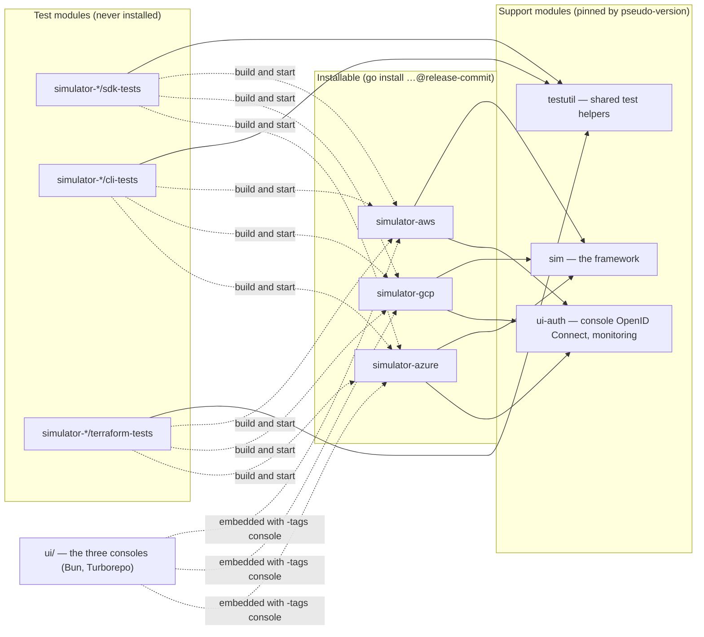
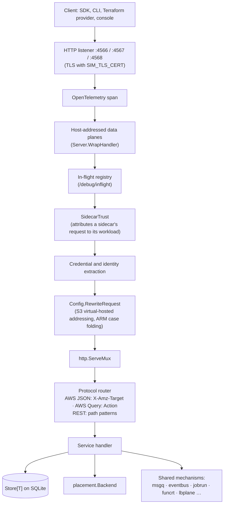
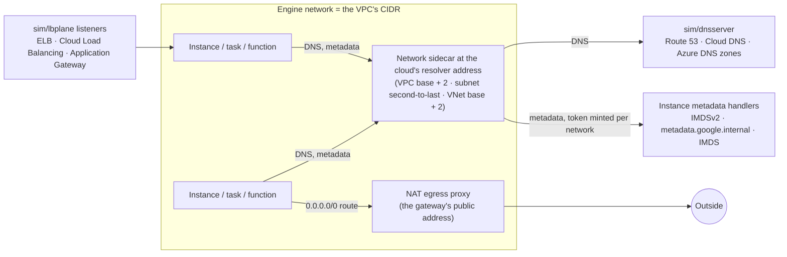

# Architecture

This page shows how the simulators are built: the modules, the path a request
takes, how state is kept and recovered, and how workloads, networks and data
planes run. [`specifications.md`](specifications.md) covers where each API's
shape comes from, and [`maintaining.md`](maintaining.md) covers how the code is
tested and released.

## Modules

| Module | Path | Role |
|---|---|---|
| `simulator-aws`, `simulator-gcp`, `simulator-azure` | `simulator-<cloud>/` | One binary per cloud. Every service slice of that cloud registers on one `sim.Server` mux. No `replace` directives, so `go install` works. |
| `sim` | `sim/` | The cloud-neutral framework: server, configuration, state, container engine, placement, networks and the shared service mechanisms. [`sim/README.md`](../sim/README.md) lists every file and package. |
| `ui-auth` | `ui-auth/` | The consoles' OpenID Connect layer and `GET /monitoring/observation`. |
| `testutil` | `testutil/` | Helpers the nine test suites share: `simready`, `freeports`, `baseimage`, `scratchimage`, `uniquename`, `httpsgateway`, `registrytrust`, `samlidp`, `githttp`. |
| Test suites | `simulator-<cloud>/{sdk,cli,terraform}-tests/` | Each `TestMain` builds the simulator, starts it and waits for its `Listening on` line. The suites drive it with the cloud's own SDK for Go, CLI and Terraform provider. |
| Consoles | `ui/packages/simulator-<cloud>` | Each console reads only the cloud's real APIs at a configured base URL. |

The root `go.work` resolves the support modules locally during development.
Each simulator pins them by pseudo-version, so a build outside the workspace
(`GOWORK=off`) compiles against exactly what was pushed.

## A request's path

- **Listeners.** One HTTP port per cloud. Google Cloud also serves gRPC on
  4569 (`SIM_GCP_GRPC_PORT`) for Cloud Logging, Bigtable, Firestore, Pub/Sub,
  Spanner, Cloud KMS and Secret Manager. The DNS listener (`sim/dnsserver`)
  and Azure Service Bus's AMQP listener are separate ports.
- **Routing.** The AWS simulator dispatches AWS JSON protocol requests on
  `X-Amz-Target` (`AWSRouter`) and AWS Query requests on `Action`
  (`AWSQueryRouter`). REST services, all of Google Cloud and all of Azure
  register path patterns on the mux. A data plane addressed by host name,
  such as an Amazon S3 virtual-hosted bucket or an Azure storage account,
  claims its requests in a `WrapHandler` layer before the mux sees them.
- **What stays with the cloud.** Error shapes, protocol routers, sandbox
  profiles, registry behaviour, DNS visibility and console coordinates live in
  each cloud's module. They reach `sim` through hooks, never through a
  `switch provider`.
- **Startup.** `sim.Main` runs one `sim.Program`:
  1. reads the configuration;
  2. runs `Configure`;
  3. builds the server, which opens the container engine and the database;
  4. starts the extra listeners (`Start`);
  5. serves until a signal.

  It exits at the first step that fails. Without a container engine it
  refuses to start, unless `SIM_RUNTIME=process` asks for an API-only process.

## State

Every resource lives in a `sim.Store[T]`:

| Implementation | When |
|---|---|
| `MemoryStore[T]` | `SIM_PERSIST` unset: state lasts as long as the process. |
| `SQLiteStore[T]` | `SIM_PERSIST=true`: one `(key TEXT PRIMARY KEY, value BLOB)` table per store, in `<SIM_DATA_DIR>/simulator.db`. |
| `CachedSQLiteStore[T]` | Stores whose request path reads many rows at once, such as Amazon DynamoDB items: every row in memory, written through to SQLite. |

- SQLite runs in WAL mode, with a 5-second busy timeout and `synchronous=NORMAL`, through the CGO-free `modernc.org/sqlite`.
- A value is the resource's JSON inside a persistence envelope. Fields tagged `json:"-"` stay off the wire but survive a restart, and fields tagged `persist:"-"` (channels, process handles) are rebuilt.
- `Upsert` is one read-modify-write under one lock.
- `Prune` deletes expired rows in bounded batches.
- `Generation` advances on every write. `GenerationIndex` uses it to rebuild a keyed lookup only when something changed.
- `PrefixStore[T]` has no whole-store read. The object stores (Amazon S3, Cloud Storage, Azure Blob Storage) use it, so a full scan of object data doesn't compile. `scripts/check-store-scans.sh` holds full-store reads on request paths at zero.
- Object bytes never live in rows. `sim.Payloads` writes each object's contents to a file of its own before the row that names it, and releases the replaced file afterwards. A crash leaves at worst an unreferenced file, which the startup sweep removes.
- `signals.Keyed` wakes a waiter when the key it watches is written. Long polls, operation waits, Step Functions task tokens, Firestore `Listen` and metadata `wait_for_change` wait on the write itself, never on a timer. `sim.Announcing` wraps a store so every write announces itself.

### Recovery after a restart

A workload container carries the labels `sockerless-sim`,
`sockerless-sim-provider`, `sockerless-sim-run` and, with persistence,
`sockerless-sim-state` (the state directory's identity), plus the service's
own resource labels. With persistence on, shutdown leaves workloads running.
On the next start, each service:

1. Reads the resources whose state says a workload should exist: a running Amazon ECS task, a running Cloud Run execution, a database server's engine, and so on.
2. Finds their containers with `sim.FindExistingContainers`, using the labels it set at creation.
3. Adopts a running container with `sim.AdoptContainer`. That re-attaches log streaming, the exit watch and the data-plane address, without restarting anything.
4. Records an exited container's result the way the live watch would have. A workload the cloud would restart starts again, keeping its filesystem.
5. Marks a resource whose container is gone as stopped, with the reason the cloud reports for a lost host.

Without persistence, a detached reaper removes the run's containers when the
simulator exits. The next start's sweep collects what a killed run left. Both
are scoped by state directory, so concurrent test suites never touch each
other's containers.

## Workloads

Every service that runs user code places it through one interface,
`placement.Backend`: `Place`, `PlaceMember`, `Adopt`, `Find`, `Console` and
`Capture`, returning a `Handle` with wait, stop, exec, address, published port
and ingress. Two backends implement it:

| Backend | What it runs | Chosen by |
|---|---|---|
| Container | A container on the Docker or Podman engine the simulator started against. | Default for every service. |
| MicroVM | A Firecracker guest on a node agent, built from the same OCI image the container backend would run. | `SIM_PLACEMENT=service[:qualifier]=microvm`, comma-separated, for example `ec2=microvm,ecs:FARGATE=microvm`. |

The service names `SIM_PLACEMENT` takes:

| Cloud | Names |
|---|---|
| AWS | `ec2` (Amazon EC2), `ecs` with the launch type as qualifier (Amazon ECS), `lambda` (AWS Lambda), `batch` (AWS Batch) |
| Google Cloud | `compute` (Compute Engine), `run` (Cloud Run and Cloud Run functions), `redis` (Memorystore for Redis), `cloudbuild` (Cloud Build) |
| Azure | `virtualmachines` (Azure Virtual Machines), `containerapps` (Azure Container Apps), `containerinstances` (Azure Container Instances), `web` (Azure App Service and Azure Functions) |

The relational engines of Amazon RDS, Cloud SQL and Azure Database for
PostgreSQL and MySQL run on the container backend through `sim/dbengine`.
- **Machine images** are OCI images. An AMI, a Compute Engine image or an Azure Marketplace image names a pinned image from the simulator's catalog. `sim/vminstance` runs the image's cloud-init over the instance's user data.
- **Real configuration drives the lifecycle.** A Cloud Run job honours its task `timeout`, an Azure Container Apps job its `replicaTimeout`, an Amazon ECS container its `stopTimeout`. Amazon ECS has no execution timeout, so a task runs until its process exits or `StopTask`.
- **Logs** stream into the cloud's own sink while the workload runs:
  - CloudWatch Logs for Amazon ECS (`awslogs`) and AWS Lambda;
  - Cloud Logging for Cloud Run and Cloud Run functions;
  - Log Analytics for Azure Container Apps and Azure Functions.

  Clients read them back through the same query APIs as on the cloud.
- **Exec reaches the real container.** Amazon ECS `ExecuteCommand` and the exec surfaces of Azure App Service and Azure Container Apps run their command through the engine's exec API, bridged over each service's own WebSocket protocol.

### The no-privilege rule

The simulator process holds no host privilege. That rules out:
- capabilities and devices;
- privileged ports;
- network namespaces of its own making and `nftables` rules;
- helper containers holding privilege on its behalf.

It talks to the container engine as an ordinary client. A workload container
holds no capability, engine socket, host network or host mount either, even
when the cloud lets a workload ask for one; what that rules out is a recorded
gap. No workload runs as a host process: every SDK suite's
`host_dispatch_test.go` fails on any `os/exec` call in production code
outside a short allow list, whose entries are the reaper and the docker-CLI
build steps.

### Node agents

A node agent is a container the simulator starts, with `/dev/kvm` granted by
the engine, when `SIM_PLACEMENT` names a microVM service. It boots pinned
Firecracker guests over virtio-MMIO and serves the placement interface over
HTTP, under a credential the simulator mints for it.
- **Networking.** Each guest's tap device sits on a bridge in the agent's own
  network namespace. The agent filters traffic at the tap, applying the
  guest's security group, firewall or network security group: direction,
  protocol, ports, CIDRs, priorities and stateful return traffic.
- **Lifecycle.** A guest's disk outlives its process, so a stopped machine
  keeps its disk and can be captured.
- **Failure.** Without `/dev/kvm` the agent refuses to start, and the
  services configured onto it fail with the cloud's provisioning error.

`make node-agent-test` boots a guest and runs `testdata/eval-arithmetic` in
it; the `firecracker` CI job runs it.

## Networks

A VPC, a Google Cloud VPC network or an Azure virtual network is an engine
network over the resource's own CIDR (`sim.EnsureCloudNetwork`, with
`sim/ipam` keeping the address ledger). A subnet is a range inside it. Every
workload is a member whose engine-assigned address is the address the cloud
API reports.

- **Resolver and metadata.** The resolver and metadata server are one sidecar per network, at the address the cloud reserves inside the network's range. It forwards DNS to `sim/dnsserver` and metadata requests to the simulator, under a token minted for that network. The resolver therefore knows which network asked, and private zones resolve only where the cloud makes them visible.
- **NAT.** An Amazon VPC NAT gateway, Cloud NAT or Azure NAT Gateway is a sidecar egress proxy whose address is the gateway's public address.
- **Load balancers.** These are `sim/lbplane` listeners with TLS termination, health probes (HTTP, TCP and gRPC) and forwarding. `lbplane.HostRouter` fronts every service that serves a workload on a host name of its own: Cloud Run, Cloud Run functions, Azure Container Apps ingress, App Service sites and AWS Lambda function URLs.
- **Security rules.** Security groups, firewall rules and network security groups apply to every flow the simulator mediates: load balancers, published ports, NAT egress. Traffic between two containers on one network is filtered only on node agents, because filtering it on the engine would need a capability.
- **Test ranges.** Two live networks over one range can't coexist on one engine. So each test that places a workload names its own range, and `scripts/check-test-network-ranges.go` enforces it.

## Shared service mechanisms

The same mechanism serves the same idea in every cloud:

| Mechanism | Package | Serves |
|---|---|---|
| Leased queues and long polls | `sim/msgq` | Amazon SQS, Pub/Sub subscriptions, Azure Service Bus, Azure Queue Storage, Cloud Tasks |
| Event fan-out | `sim/eventbus` | Amazon EventBridge, Amazon SNS, Azure Event Grid, Pub/Sub topics, Eventarc |
| Push delivery with retries and dead letters | `sim/delivery` | SNS HTTP subscriptions, Event Grid, Cloud Tasks HTTP tasks, Pub/Sub push |
| Partitioned logs | `sim/streamlog` | Amazon Kinesis Data Streams, Azure Event Hubs |
| Schedules | `sim/cron` | Cloud Scheduler, EventBridge Scheduler, Container Apps scheduled jobs |
| Run-to-completion jobs | `sim/jobrun` | Cloud Run jobs, Container Apps jobs |
| Function execution environments | `sim/funcrt` | AWS Lambda pools, concurrency, provisioned concurrency, event-source pollers |
| Replica sets and probes | `sim/replicas`, `sim/revisions` | Cloud Run services and worker pools, Container Apps revisions |
| Relational engines | `sim/dbengine`, `pgwire`, `mysqlwire` | Amazon RDS, Cloud SQL, Azure Database for PostgreSQL and MySQL |
| Cache engines | `sim/cacheengine` | Amazon ElastiCache, Memorystore for Redis, Azure Cache for Redis |
| Object contents | `sim/blobstore`, `sim/sparse` | Amazon S3, Cloud Storage, Azure Blob Storage and Files, Amazon EBS snapshots |
| Lists, filters and page tokens | `sim/listq` | Every list operation with a filter or order grammar |
| Keys and tokens | `sim/simkms`, `sim/simjwt`, `sim/oidcfed` | AWS KMS, Cloud KMS, Azure Key Vault; each cloud's token issuer; workload identity federation |
| Container registries | `sim/oci.go`, `sim/ociauth.go` | Amazon ECR, Artifact Registry, Azure Container Registry |

Each package keeps what is generic, and each cloud keeps its wire shapes,
states and errors.

## Consoles

`ui/` builds three single-page consoles. A console calls only the real cloud
APIs of its simulator, at a base URL from `GET /ui/config.json`. It signs
operators in through the cloud's own federation primitive:
- Workforce Identity Federation for Google Cloud;
- `AssumeRoleWithWebIdentity` for AWS;
- Microsoft Entra ID for Azure.

A `-tags console` build embeds the bundle that `make simulator-<cloud>/embed`
copied into `simulator-<cloud>/dist/` (git-ignored). A plain build serves the
directory `SIM_CONSOLE_DIR` names, or no console.
[`configuration.md`](configuration.md#consoles) lists the console's OpenID
Connect settings.
