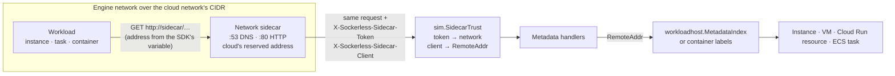

# Instance metadata

A workload the simulators run reads facts about itself and the credentials of
its identity from an endpoint inside its own network: the Amazon EC2 Instance
Metadata Service, the Amazon ECS task metadata and container credentials
endpoints, the Google Cloud metadata server, the Azure Instance Metadata
Service, and the managed-identity endpoint App Service, Azure Functions and
Azure Container Apps give their workloads. This page describes what each one
serves, where each answer comes from, and what it does not model.

Every handler named here registers on the cloud's single `sim.Server` mux. The
handler decides who is asking from the request's source address, never from
anything the request body or a query parameter claims.

## The shared mechanism

### One sidecar per network

Every engine network a simulator places workloads on carries one sidecar
container (`sim/sidecar`). `sidecar.Manager.Ensure` (`sim/sidecar/manager.go`)
starts it at the address the cloud reserves inside the network's own range:

| Cloud | Network | Sidecar address | Chosen by |
|---|---|---|---|
| AWS | VPC | VPC base + 2, the Amazon Route 53 Resolver's address | `ec2VPCResolverAddress` (`simulator-aws/ec2_vpc_network.go`) |
| AWS | Platform network (no VPC) | Range base + 2 | `awsPlatformNetwork` (`simulator-aws/aws_networks.go`) |
| Google Cloud | Subnetwork | Second-to-last address of the primary range | `gcpSubnetworkSidecarAddress` (`simulator-gcp/gcp_networks.go`) |
| Google Cloud | Platform network | Range base + 2 | `gcpPlatformNetwork` |
| Azure | Virtual network | Lowest subnet's base + 2 | `azureVNetResolverAddress` (`simulator-azure/azure_workload_networks.go`) |
| Azure | Platform or Container Apps environment network | Range base + 2 | `azureEnsureSidecar` with the zero address |

A platform network is the `/24` of `100.64.0.0/10` that `sim.EnsurePlatformNetwork`
(`sim/cloudnet.go`) gives the workloads that sit on no cloud network: a Cloud
Run service without VPC egress, a bridge-mode Amazon ECS task, an App Service
app outside a virtual network.

The sidecar binary (`sim/sidecar/cmd/sidecar/main.go`, function `run`) listens
on UDP and TCP port 53 for DNS and TCP port 80 for HTTP. Every workload on the
network names the sidecar as its resolver. The sidecar's `proxyHandler`
forwards every HTTP request, on any path, to the simulator's callback origin
(`workloadhost.CallbackAddr`). It strips any `X-Sockerless-Sidecar-Token` and
`X-Sockerless-Sidecar-Client` the workload sent, then sets them itself: the
token the simulator minted for this network, and the address of the client
that connected.

### Trusting the forwarded address

`sidecar.Manager.Ensure` mints the token with `sim.NewSidecarToken` and
registers it with `sim.RegisterSidecarToken` for that network. `sim.SidecarTrust`
(`sim/sidecar_trust.go`) runs in every simulator's middleware chain
(`sim/server.go`). It reads and removes both headers from every request. When
the token is registered, it replaces `r.RemoteAddr` with the forwarded client
address and records the network in the request context, which
`sim.SidecarNetwork` returns. Without a registered token the headers are
discarded and `RemoteAddr` stays the TCP peer. A workload that calls the
simulator directly therefore cannot claim another workload's address.

### Attributing a request to its workload

The metadata handlers key on `RemoteAddr`:

- `workloadhost.MetadataIndex[T]` (`sim/workloadhost/workloadhost.go`) maps a
  private IPv4 address to the record a metadata server answers with.
  `ForRequest` looks up the request's source host. Amazon EC2
  (`imdsInstancesByIP`), Compute Engine (`gcpMetadataInstancesByIP`) and Azure
  Virtual Machines (`azureMetadataVMsByIP`) each keep one. The machine's
  booting hook stores the address before the guest's first instruction, so
  user data can read metadata (`ec2MachineBooting`, `azureVMBooting`,
  `compute_instance_vm.go`), and the down hook deletes it.
- The Google Cloud metadata server also places Cloud Run, Cloud Run functions
  and Cloud Build containers. `containerMetadataWorkload`
  (`simulator-gcp/metadata_workload.go`) lists the simulator's containers on
  the engine, matches the source address on the sidecar's network, and reads
  the resource from the container's labels.
- The ECS task metadata endpoint names the task in its path. For an awsvpc
  task read through a sidecar, `ecsTaskOwnsMetadataRequest`
  (`simulator-aws/metadata.go`) answers only when the source address is the
  task's elastic network interface on its VPC's network. A task without an
  interface, and any read through the simulator's own listener, is answered
  for whoever names the task ID.
- The container credentials endpoint and the Azure managed-identity endpoint
  authenticate the caller with a secret in the URL or a header, not by
  address.



### Which address a workload dials

The fixed link-local addresses do not answer. A workload that dials
`169.254.169.254`, `169.254.170.2` or `168.63.129.16` gets no route: a bridge
network carries one subnet, and routing a link-local address inside the
workload needs a capability. This is BUGS.md row **3485**
(`specs/SIMULATOR_EXECUTION.md` calls it "a recorded gap"). The simulators
hand each workload the sidecar's address through an environment variable
instead:

| Workload | Variables set | Set by |
|---|---|---|
| Amazon EC2 instance | `AWS_EC2_METADATA_SERVICE_ENDPOINT=http://<sidecar>/`, `AWS_EC2_METADATA_SERVICE_ENDPOINT_MODE=IPv4` | `ec2MetadataEnv` (`simulator-aws/metadata.go`) |
| Amazon ECS task, awsvpc or bridge | `ECS_CONTAINER_METADATA_URI_V4` and `ECS_CONTAINER_METADATA_URI`, both `http://<sidecar>/v4/<task-id>` | `ecsTaskMetadataEnv` |
| Amazon ECS task, host mode | The same two, at the simulator's callback address | `hostNetworkMetadataEnv` |
| Any AWS workload holding a role through a container credentials grant (ECS task, AWS CodeBuild, AWS Batch, AWS Glue, AWS Amplify compute) | `AWS_CONTAINER_CREDENTIALS_FULL_URI` | `grantContainerCredentials` (`simulator-aws/role_credentials.go`) |
| Compute Engine instance, Cloud Run, Cloud Run functions, Cloud Build | `GCE_METADATA_HOST`, `GCE_METADATA_IP`, `GCE_METADATA_ROOT`, all `<sidecar>` | `gcpWorkloadNetwork.env` (`simulator-gcp/gcp_networks.go`) |
| Azure virtual machine | `AZURE_INSTANCE_METADATA_ENDPOINT=http://<sidecar>/metadata/instance` | `azureVMInstanceSpec` (`simulator-azure/compute_vm_backend.go`) |
| App Service app or slot, Azure Functions app, container app, Container Apps job, with a managed identity | `IDENTITY_ENDPOINT=http://<sidecar>/msi/token`, `IDENTITY_HEADER` | `workloadMetadataEnv` (`simulator-azure/metadata.go`) |

Google Cloud also resolves the metadata server's names. Every Google Cloud
workload gets hosts entries `metadata.google.internal:<sidecar>` and
`metadata:<sidecar>` (`gcpWorkloadNetwork.extraHosts`), and the Cloud DNS
catalog answers `metadata.google.internal.` with the sidecar's address on the
asking network (`cloudDNSCatalog`, `simulator-gcp/dns_resolver.go`). So
`curl http://metadata.google.internal/…` works on Google Cloud, and a client
that dials `169.254.169.254` does not.

### Container backend and microVM guests

On the container backend a workload is a container on the engine network. A
grant of container credentials there is served on the workload's own
loopback: `grantContainerCredentials` sets
`AWS_CONTAINER_CREDENTIALS_FULL_URI=http://127.0.0.1:51679/v2/credentials/<id>`
and places the workload behind a forwarder (`placement.ContainerBackend.PlaceForwarded`,
`sidecar.StartForwarder`). The forwarder owns the workload's network namespace
and relays `127.0.0.1:51679` to the sidecar's port 80. The AWS SDKs'
container credential provider accepts a plain-HTTP full URI only on a loopback
or the endpoint's link-local address, so this is the form it takes.

On a node agent's microVM backend, a guest is a Firecracker machine bridged
onto the same engine network through a tap. It reaches the same sidecar at the
same address (`specs/SIMULATOR_REAL_EXECUTION.md`, "Guests"). That backend is
no `placement.Forwarding`, so a grant there names the sidecar itself:
`AWS_CONTAINER_CREDENTIALS_FULL_URI=http://<sidecar>/v2/credentials/<id>`.
The AWS SDKs' provider refuses that URI, and so it does for a host-mode ECS
task, whose URI names the simulator's callback address. Only a client that
reads the endpoint itself holds the role there (BUG-3485).

## Amazon EC2 and Amazon ECS

### Instance Metadata Service

`registerEC2IMDS` (`simulator-aws/ec2_imds.go`) serves the paths below. Every
`GET` goes through `imdsRequest`, which applies these rules in order:

1. A source address no instance holds, or an instance whose
   `MetadataHttpEndpoint` is `disabled`, gets **404** with the IMDS HTML body
   (`imdsNotFound`).
2. No `X-aws-ec2-metadata-token` header: answered when `MetadataHttpTokens` is
   `optional` (IMDSv1), **401** with the IMDS HTML body when it is `required`.
3. A token that was never issued, was issued to another instance, or has
   expired gets **401**.

The token endpoint `PUT /latest/api/token` applies rule 1, then refuses a
request carrying `X-Forwarded-For` with **403**, then requires
`X-aws-ec2-metadata-token-ttl-seconds` between 1 and 21600 (`imdsMaxTokenTTL`)
and refuses anything else with **400**. It answers a token `AQ` followed by
56 hex digits, bound to the instance, and echoes the TTL in
`X-Aws-Ec2-Metadata-Token-Ttl-Seconds`. Each issue sweeps expired tokens from
`imdsTokens`. Tokens live in process memory and do not survive a restart.

`HttpPutResponseHopLimit` round-trips through RunInstances, launch templates,
`ModifyInstanceMetadataOptions` and DescribeInstances, but the service does
not enforce it as the response's IP TTL (BUG-3528).

All leaves answer `text/plain`, JSON documents included, as IMDS does. The
"Source" column names the vendored page under `specs/cloud-api/aws/`;
`ec2-instance-metadata-categories.md.gz` is the only vendored IMDS page.

| Path | Method | Answer | Value from | Source |
|---|---|---|---|---|
| `/latest/api/token` | PUT | Token text | Random, per instance | none vendored |
| `/latest/meta-data/` | GET | Listing | `imdsListing`: `iam/` only with a profile role, `public-keys/` only with a key pair, `tags/` only when tags are allowed, `public-ipv4` and `public-hostname` only when set | categories page |
| `…/instance-id`, `instance-type`, `ami-id`, `local-ipv4` | GET | Text | The instance record | categories page |
| `…/hostname`, `local-hostname` | GET | Text | `ec2PrivateDNSName`: `ip-a-b-c-d.ec2.internal` in us-east-1, `.<region>.compute.internal` elsewhere | categories page |
| `…/ami-launch-index`, `reservation-id` | GET | Text | The instance record | categories page |
| `…/instance-action` | GET | `none` | Fixed | categories page |
| `…/instance-life-cycle` | GET | `on-demand` or the instance's lifecycle (`spot`) | The instance record | categories page |
| `…/mac` | GET | Text | `ec2InterfaceMAC` of the primary interface | categories page |
| `…/security-groups` | GET | Group names, one per line | The instance's groups | categories page |
| `…/public-ipv4`, `public-hostname` | GET | Text, or 404 | Public address; public DNS name only when the VPC enables DNS hostnames | categories page |
| `…/placement/`, `placement/region`, `placement/availability-zone` | GET | Text | `awsRegion()`; the subnet's zone | categories page |
| `…/services/`, `services/domain`, `services/partition` | GET | `amazonaws.com`, `aws` | Fixed | categories page |
| `…/block-device-mapping/`, `…/{device}` | GET | `ami`, `root`, `ebsN` | Root device name; attached Amazon EBS volumes in attach order | categories page |
| `…/network/interfaces/macs/` and `…/{mac}/` | GET | Listing | The instance's interfaces in device order | categories page |
| `…/network/interfaces/macs/{mac}/{key}` | GET | Text | `imdsInterfaceKeys`: `device-number`, `interface-id`, `local-hostname`, `local-ipv4s`, `mac`, `network-card-index`, `owner-id`, `security-group-ids`, `security-groups`, `subnet-id`, `subnet-ipv4-cidr-block`, `vpc-id`, `vpc-ipv4-cidr-block(s)`, and `public-ipv4s` with a public address | categories page |
| `…/macs/{mac}/ipv4-associations/`, `…/{ip}` | GET | Public addresses; the private address one maps to | Launch public address and associated Elastic IP addresses | categories page |
| `…/public-keys/`, `public-keys/0/`, `public-keys/0/openssh-key` | GET | `0=<name>`, `openssh-key`, the key | The launch key pair | categories page |
| `…/iam/`, `iam/info` | GET | Listing; JSON `Code`, `LastUpdated`, `InstanceProfileArn`, `InstanceProfileId` | The instance profile | categories page |
| `…/iam/security-credentials/`, `…/{role}` | GET | Role name; JSON `Code`, `LastUpdated`, `Type: AWS-HMAC`, `AccessKeyId`, `SecretAccessKey`, `Token`, `Expiration` | The profile's role; a session of it | categories page |
| `…/tags/`, `tags/instance`, `tags/instance/{key}` | GET | `instance`; keys sorted; the value | Instance tags, only when `InstanceMetadataTags` is `enabled` | categories page |
| `/latest/dynamic/instance-identity/document` | GET | JSON | `accountId`, `architecture`, `availabilityZone`, `imageId`, `instanceId`, `instanceType`, `pendingTime`, `privateIp`, `region`, `version: 2017-09-30`, null `kernelId`, `ramdiskId`, `billingProducts`, `devpayProductCodes`, `marketplaceProductCodes` | categories page |

Not served: `/latest/user-data`, `instance-identity/signature`, `pkcs7` and
`rsa2048`, `identity-credentials/ec2/*`, `events/maintenance/*`, `spot/`,
`history`, and the IPv6 endpoint (BUG-3528). An instance gets its user data
through cloud-init instead: `ec2InstanceSpec`
(`simulator-aws/ec2_instance_launch.go`) decodes `UserData` from base64 and
seeds it for the image's cloud-init with the `DataSourceEc2Local` datasource
(`ec2CloudInit`, `sim/vminstance`).

### Metadata options

RunInstances resolves each option from the request, then the launch template,
then the default: `HttpTokens` `optional`, or `required` for an AMI registered
with `ImdsSupport` `v2.0` (`ec2_run_instances.go`); `HttpEndpoint` `enabled`;
`InstanceMetadataTags` `disabled`; hop limit 1.
`ModifyInstanceMetadataOptions` (`handleModifyInstanceMetadataOptions`,
`ec2_instances.go`) updates the record in place. `imdsInstanceFor` reads the
record at each request, so a change applies to the next read of a running
instance without a reboot.

### Amazon ECS task metadata endpoint v4

`registerHostMetadata` (`simulator-aws/metadata.go`) serves two paths. No
vendored page states this endpoint.

| Path | Method | Answer |
|---|---|---|
| `/v4/{task-id}/task` | GET | JSON `Cluster`, `TaskARN`, `Family`, `Revision`, `DesiredStatus`, `KnownStatus`, `LaunchType`, and `Containers` (`ecsTaskMetadataV4`) |
| `/v4/{task-id}` | GET | The task definition's first container (`ecsContainerMetadataV4`) |

Each container carries `DockerId`, `DockerName`, `Name`, `Image`,
`KnownStatus`, `Limits` (`CPU`, `Memory` from the task definition) and, for an
awsvpc task, `Networks` with `NetworkMode: awsvpc` and the ENI address. Both
paths wait for a task start under way to settle (`ecsAwaitTaskStart`), so a
container that reads its metadata at once finds its siblings. An unknown task
or a task whose container has no engine handle yet answers **404** with the
text `ECS task metadata not found` (`ECS container metadata not found` at
`/v4/{task-id}`).

`/v4/{task-id}/stats` and `/v4/{task-id}/task/stats` are not served.

### Container credentials endpoint

`registerRoleCredentials` (`simulator-aws/role_credentials.go`) serves
`GET /v2/credentials/{id}`. The ID is 32 random hex digits that
`grantContainerCredentialsAt` stores in `containerCredentialGrants`. The ID is
the only secret: the endpoint reads no `Authorization` header, and the
simulator sets no `AWS_CONTAINER_AUTHORIZATION_TOKEN` and no
`AWS_CONTAINER_CREDENTIALS_RELATIVE_URI`.

| Case | Status | Body |
|---|---|---|
| Live grant | 200 | `RoleArn`, `AccessKeyId`, `SecretAccessKey`, `Token`, `Expiration` |
| Unknown ID, or the holder no longer runs | 404 | `{"code":"NotFound","message":"Credentials not found"}` |
| The role was deleted | 400 | `{"code":"InvalidRole","message":"Unable to assume role <arn>"}` |

A workload with no role gets no grant and no variable.

### AWS Lambda

A function has no metadata endpoint. `lambda_environment.go` hands the
execution role's session to the function in `AWS_ACCESS_KEY_ID`,
`AWS_SECRET_ACCESS_KEY` and `AWS_SESSION_TOKEN`
(`roleEnvironmentCredentialsExpiring`), with the function's facts in
`AWS_LAMBDA_FUNCTION_NAME`, `AWS_LAMBDA_FUNCTION_VERSION`,
`AWS_LAMBDA_FUNCTION_MEMORY_SIZE`, `AWS_REGION`, `AWS_DEFAULT_REGION`,
`AWS_LAMBDA_LOG_GROUP_NAME`, `AWS_LAMBDA_LOG_STREAM_NAME`, `_HANDLER`,
`AWS_LAMBDA_INITIALIZATION_TYPE` and `AWS_LAMBDA_RUNTIME_API`. The simulator
retires the execution environment before the session lapses
(`env.expires`), so a function never holds an expired session. It also sets
`AWS_ENDPOINT_URL` to its callback address unless the function's own
environment names one. The vendored `lambda-runtime-environment.md.gz` says
the environment shares credentials with extensions; it does not list the
variables.

### How AWS mints the sessions

The instance metadata service and the container credentials endpoint serve
sessions through `roleSessionCredential`. A holder (`ec2:<instance-id>`,
`ecs:<task-id>`, `lambda:<function>`, and the CodeBuild, Batch, Glue and
Amplify holders in `roleHolderLive`) gets one session per role. The session
lasts one hour (`roleSessionLifetime`). The endpoint serves the same session
until less than 30 minutes remain (`roleSessionMinRemaining`), then mints the
next. `stsMintTempCred` (`simulator-aws/sts.go`) makes an `ASIA` access key ID
and a session token sealed with an HMAC and the expiry. The session's
principal is `arn:aws:sts::<account>:assumed-role/<role>/<session-name>`. An
instance's session is named for its instance ID; an ECS task's for its task
ID. A sweep drops the grants and sessions of holders that no longer run.

### Example: an instance reads its metadata

`TestIMDS_InstanceReadsItsOwnMetadataAndRoleSession`
(`simulator-aws/sdk-tests/ec2_imds_test.go`) launches an Amazon Linux 2023
instance with an instance profile and `InstanceMetadataTags: enabled`, then
runs these commands in the guest through AWS Systems Manager:

```sh
token=$(curl -sS -X PUT "${AWS_EC2_METADATA_SERVICE_ENDPOINT}latest/api/token" \
  -H "X-aws-ec2-metadata-token-ttl-seconds: 60")
curl -sS -H "X-aws-ec2-metadata-token: $token" \
  "${AWS_EC2_METADATA_SERVICE_ENDPOINT%/}/latest/meta-data/instance-id"
curl -sS -H "X-aws-ec2-metadata-token: $token" \
  "${AWS_EC2_METADATA_SERVICE_ENDPOINT%/}/latest/meta-data/iam/security-credentials/<role>"

# The AMI requires IMDSv2: no token answers 401, a TTL over six hours 400.
curl -sS -o /dev/null -w '%{http_code}' \
  "${AWS_EC2_METADATA_SERVICE_ENDPOINT}latest/meta-data/instance-id"        # 401
curl -sS -o /dev/null -w '%{http_code}' -X PUT \
  -H "X-aws-ec2-metadata-token-ttl-seconds: 21601" \
  "${AWS_EC2_METADATA_SERVICE_ENDPOINT}latest/api/token"                    # 400
```

The test then calls STS `GetCallerIdentity` with the session and gets
`arn:aws:sts::<account>:assumed-role/<role>/<instance-id>`. After
`ModifyInstanceMetadataOptions` sets `HttpEndpoint` to `disabled`, the token
`PUT` answers 404.

### Example: a task reads its metadata and its role

`TestECS_TaskRoleCredentialsAuthorizeWorkloadAWSCLI`
(`simulator-aws/sdk-tests/ecs_task_role_credentials_test.go`) runs the AWS CLI
image in an awsvpc task and a bridge task under a task role. The container
fetches the credentials twice and checks that both carry the same access key,
then runs `aws sts get-caller-identity` through the CLI's default chain:

```sh
curl --fail --silent "$AWS_CONTAINER_CREDENTIALS_FULL_URI"
aws sts get-caller-identity --query Arn --output text
```

`TestECSNetworkModeHostUsesTheContainerInstanceNetworkStack`
(`simulator-aws/cli-tests/ecs_network_mode_test.go`) reads the task metadata
of a host-mode task with
`docker exec <container> sh -c 'wget -T 5 -q -O - "$ECS_CONTAINER_METADATA_URI_V4/task"'`
and checks that the answer names the task.

### Tests

| Suite | Test | Covers |
|---|---|---|
| SDK | `TestIMDS_RefusesACallerThatIsNoInstance` (`ec2_imds_test.go`) | 404 for the token, a leaf, the credentials listing and the identity document from a non-instance |
| SDK | `TestIMDS_InstanceReadsItsOwnMetadataAndRoleSession` | Token rules, every category above, tags, profile session, endpoint disabled |
| SDK | `TestECSTaskMetadataV4_UnknownTask` | 404 for a task never run |
| SDK | `TestEC2_InstanceRunsUserDataAndReadsItsMetadata` (`ec2_instances_test.go`) | User data reads `instance-id` and `local-ipv4` with a token |
| SDK | `TestEC2_InstanceRunsItsCloudConfig` (`ec2_cloud_init_test.go`) | `public-keys/` |
| SDK | `TestEC2_RunInstancesLaunchesASpotInstance` (`ec2_spot_launch_test.go`) | `instance-life-cycle` of a Spot Instance |
| SDK | `TestECS_TaskRoleCredentialsAuthorizeWorkloadAWSCLI` | Container credentials, awsvpc and bridge |
| SDK | `TestECS_TaskResolvesAPrivateHostedZoneThroughTheVPCResolver` (`ec2_instances_test.go`) | Task metadata through the VPC's sidecar |
| SDK | `TestCodeBuild_BuildHoldsItsServiceRoleSession_SDK`, `TestBatch_JobHoldsItsJobRoleSession_SDK`, `TestGlue_JobRunHoldsItsRoleSession_SDK` (`workload_role_credentials_test.go`) | Container credentials grants of other services |
| CLI | `TestECSNetworkModeHostUsesTheContainerInstanceNetworkStack` | Task metadata of a host-mode task |
| CLI | `TestEC2CLI_SerialConsoleAndMetadataDefaults` (`ec2_instance_mgmt_test.go`) | Account-level metadata defaults |
| Terraform | `launch-template/main.tf`, `idempotency-fidelity/main.tf` | `metadata_options` round-trip; no Terraform test reads metadata from a workload |

## Google Cloud

### Admission

`gceMetadataAdmit` (`simulator-gcp/metadata_workload.go`) admits every read:

1. `gceMetadataCaller` places the caller: a Compute Engine instance by
   `gcpMetadataInstancesByIP`, else a Cloud Run or Cloud Build container by
   `containerMetadataWorkload`. A loopback address or any other caller gets
   **404** `404 page not found` and no `Metadata-Flavor` header.
2. A read without `Metadata-Flavor: Google` gets **403**
   `Missing Metadata-Flavor:Google header.`
3. Every admitted answer carries `Metadata-Flavor: Google` and
   `Server: Metadata Server for VM`.

The root `GET /` with `Metadata-Flavor: Google` from a workload answers the
listing `computeMetadata/`. It is the residency probe the Google auth
libraries send before they resolve Application Default Credentials.
`registerComputeMetadataDirectories` handles it in a wrapper ahead of the mux,
because the console also owns `/`.

`simulator-gcp/token_signing.go` exempts `/computeMetadata/` from bearer
authentication.

### Paths

`registerComputeMetadata` (`simulator-gcp/metadata.go`) serves the leaves, and
one tree, `gceMetadataEntry`, describes the directories, the listings and the
recursive JSON. Leaves answer `Content-Type: application/text`. Only
`cloudrun-container-contract.md.gz` under `specs/cloud-api/gcp/` is vendored;
no Compute Engine metadata page is.

| Path under `/computeMetadata/v1/` | Answer | Value from | Source |
|---|---|---|---|
| `project/project-id` | Text | The workload's project, resolved through Cloud Resource Manager | Cloud Run contract |
| `project/numeric-project-id` | Text, or 404 when Cloud Resource Manager holds no number | Cloud Resource Manager | Cloud Run contract |
| `project/attributes/`, `project/attributes/{key}` | Listing; text | `commonInstanceMetadata` of the project (`gceProjectAttributes`) | none vendored |
| `instance/id` | Text | Compute Engine: the instance's numeric `id`. Cloud Run: the container's engine ID. Cloud Build: `1000000000001` | Cloud Run contract |
| `instance/name` | Text | The instance's name, else `sim-instance-1` | none vendored |
| `instance/hostname` | Text | `<name>.<zone>.c.<project>.internal` | none vendored |
| `instance/zone` | Text | `projects/<number>/zones/<zone>`; for Cloud Run `projects/<number>/zones/<region>-1`; for Cloud Build the `zone` query parameter or `us-central1-a` | Cloud Run container contract |
| `instance/region` | Text, Cloud Run only | `projects/<number>/regions/<region>` from the resource name | Cloud Run contract |
| `instance/attributes/`, `instance/attributes/{key}` | Listing; text | The instance's `metadata.items`, `startup-script` and `user-data` among them; empty outside Compute Engine | none vendored |
| `instance/network-interfaces/`, `…/{nic}/`, `…/{nic}/{key}` | Listing; text | Compute Engine only: `ip`, `mac`, `mtu` (1460), `network` (`projects/<number>/networks/<name>`), `gateway`, `subnetmask`, and on interface 0 `dns-servers` | Cloud Run contract (worker pools) |
| `instance/network-interfaces/{nic}/access-configs/{n}/{key}` | Text | `external-ip`, `type` | none vendored |
| `instance/service-accounts/` | Listing `default/` and `<email>/` | The workload's account | none vendored |
| `instance/service-accounts/{sa}/` | Listing `aliases`, `email`, `identity`, `scopes`, `token` | `{sa}` is `default` or the account's email | none vendored |
| `instance/service-accounts/{sa}/email` | Text | The account | Cloud Run contract |
| `instance/service-accounts/{sa}/aliases` | `default` | Fixed | none vendored |
| `instance/service-accounts/{sa}/scopes` | `https://www.googleapis.com/auth/cloud-platform` | Fixed | none vendored |
| `instance/service-accounts/{sa}/token` | JSON `access_token`, `expires_in`, `token_type: Bearer` | `signAccessToken` | Cloud Run contract |
| `instance/service-accounts/{sa}/identity?audience=…` | JWT text; **400** without `audience` | `signIdentityToken` | none vendored |
| `universe/universe-domain` | `googleapis.com` | Fixed | none vendored |

An account other than the workload's own, under its email or any other name,
answers **404**. The `scopes` and `format` query parameters of `token` and
`identity` are not read.

### Directories, recursion and waiting

- A directory path ending in `/` answers its children, one per line, a
  directory child with a trailing slash. The same path without the slash
  answers **301** to the slash form, keeping the query
  (`redirectToMetadataDirectory`).
- `?recursive=true` on a directory answers the subtree as JSON, each
  kebab-case key spelled in camelCase (`numeric-project-id` becomes
  `numericProjectId`), with `token` and `identity` left out
  (`metadataRecursiveValue`). Attribute keys and interface indexes keep their
  own spelling.
- `alt` is not read: a leaf always answers text and a recursive directory
  always answers JSON.
- Every answer carries an `ETag`: the first 8 bytes of the SHA-256 of the body,
  in hex (`gceMetadataAnswer.etag`, `simulator-gcp/metadata_wait.go`).
- `?wait_for_change=true` holds the read until the body's ETag differs from
  `last_etag`, or from the body when the read arrived if no `last_etag` was
  sent (`gceMetadataServe`). `timeout_sec` bounds the wait and answers the
  content as it then is; a value that is not a non-negative integer answers
  **400** `Non-negative integer expected for timeout_sec`. The wait sleeps on
  `gceMetadataChanges`, which every store the tree renders from announces its
  writes to; no timer polls. A key that a write removes ends the wait with
  **404**.

### Cloud Run, Cloud Run functions and Cloud Build

Cloud Run services, revisions' instances, job executions and worker pools
reach the same handlers. `cloudRunWorkloadFromLabels` reads the project and
region from the resource name and the service account from the revision,
instance, execution template or worker-pool template. A Cloud Run functions
function runs as the Cloud Run service it creates (`cloudfunctions.go`), so it
is placed the same way. A Cloud Build step is placed by
`cloudBuildWorkloadFromLabels` and runs as the build's service account. On
Cloud Run, `instance/region` is served, `instance/attributes/` is empty and
`instance/network-interfaces/` is empty. A revision's containers also get
`K_SERVICE`, `K_REVISION` and `K_CONFIGURATION` (`cloudrunservices.go`).

### How Google Cloud mints tokens

The account a workload runs as is the one its instance or Cloud Run resource
names. A resource that names none, or names `default`, runs as the project's
Compute Engine default service account,
`<number>-compute@developer.gserviceaccount.com`. When the project has no
number, the workload has no account and `service-accounts/` is empty
(`defaultServiceAccount`).

- **Access token.** `signAccessToken` signs an RS256 JWT with the simulator's
  access-token key: `iss`, `aud` (the simulator's access-token audience),
  `sub` (the account email), `iat`, `exp` and `scope: cloud-platform`. It
  lasts one hour. Every request mints a new one; the endpoint keeps no cache.
  The simulator's bearer middleware verifies it like any other token, so the
  workload calls Google Cloud APIs with it.
- **ID token.** `signIdentityToken` signs an RS256 JWT with `aud` set to the
  requested audience and `azp`, `sub` and `email` set to the account email,
  `email_verified: true`, valid for one hour. A Cloud Run service's invoker
  check accepts it. A Google API refuses it as an access token
  (`TestMetadata_CloudRunReadsThroughTheOfficialClient`).

### Instance data's sources

| Field | Source |
|---|---|
| `id`, `name`, `zone` | The `ComputeInstance` record, read again at each request so `setMetadata` and `setTags` apply at once |
| `attributes/*` | `metadata.items` from `instances.insert` and `setMetadata` |
| `network-interfaces/*` | `networkInterfaces[n]`, its subnetwork's `gatewayAddress` and `ipCidrRange`; `mac` from `gceInterfaceMAC` of the address |
| `dns-servers` | The resolver the machine booted with |
| `project/attributes/*` | `projects.setCommonInstanceMetadata` |
| `numeric-project-id` | Cloud Resource Manager |

### Example: a Compute Engine instance reads its metadata

`TestCompute_InstanceBootsRunsItsStartupScriptAndKeepsItsDisk`
(`simulator-gcp/sdk-tests/compute_instance_boot_test.go`) boots an `e2-micro`
instance whose startup script reads the metadata server by its name, over
bash's `/dev/tcp`:

```sh
md() {
  exec 3<>/dev/tcp/metadata.google.internal/80
  printf 'GET %s HTTP/1.0\r\nHost: metadata.google.internal\r\nMetadata-Flavor: Google\r\n\r\n' "$1" >&3
  sed -e '1,/^\r$/d' <&3
  exec 3<&-
}
md /computeMetadata/v1/instance/name
md /computeMetadata/v1/instance/zone
md /computeMetadata/v1/instance/attributes/marker
md /computeMetadata/v1/project/attributes/project-marker
md /computeMetadata/v1/instance/network-interfaces/0/ip
md /computeMetadata/v1/instance/network-interfaces/0/access-configs/0/external-ip
```

The guest's startup-script runner fetches
`/computeMetadata/v1/instance/attributes/startup-script` the same way at every
boot (`gcpStartupScriptRunner`, `simulator-gcp/compute_instance_vm.go`).

With `curl` in the guest, the equivalent is:

```sh
curl -s -H 'Metadata-Flavor: Google' \
  http://metadata.google.internal/computeMetadata/v1/instance/service-accounts/default/token
```

### Tests

| Suite | Test | Covers |
|---|---|---|
| SDK | `TestMetadata_FromOutsideEveryWorkload` (`sdk-tests/metadata_test.go`) | 404 without the flavor header coming back for a non-workload |
| SDK | `TestMetadata_CloudRunReadsThroughTheOfficialClient` | `cloud.google.com/go/compute/metadata`, listings, recursive reads, flavor header, residency probe, access and ID tokens, empty attributes, Application Default Credentials |
| SDK | `TestMetadata_CloudRunSubscribesToProjectAttributes` | `Subscribe`: `wait_for_change` with `last_etag`, a change and a removal |
| SDK | `TestMetadataSDK_CloudRunWorkloadIdentity` (`metadata_credentials_test.go`) | The workload's identity through the official client |
| SDK | `TestCompute_InstanceBootsRunsItsStartupScriptAndKeepsItsDisk` | Instance and project keys from a Compute Engine guest |
| CLI | `TestGCEMetadataServerGcloudCredentials` (`cli-tests/metadata_gcloud_test.go`) | `gcloud auth list`, `print-access-token`, `application-default print-access-token` inside a Cloud Run job's network namespace |
| CLI | `TestGcloudComputeInstances_Lifecycle` (`cli-tests/compute_instances_test.go`) | `instance/name` from a guest |
| Unit | `TestMetadataDirectoryListingsResolve`, `TestMetadataRootResidencyProbe`, `TestMetadataDirectoryRedirectsToTrailingSlash`, `TestMetadataRecursiveOmitsMintedLeaves`, `TestMetadataDirectoryRequiresFlavorHeader`, `TestMetadataReadWaitsForAChange`, `TestMetadataPlacesCloudRunWorkloads` | The tree, redirects, recursion and waits |
| Terraform | none | The provider reads no metadata server |

## Azure

### Instance Metadata Service

`registerMetadata` and `registerAzureInstanceAttestation`
(`simulator-azure/metadata.go`) and `handleIMDSIdentityToken`
(`simulator-azure/managedidentity.go`) serve the virtual machine's paths. A
request is a machine's when its source address is in `azureMetadataVMsByIP`;
`azureIMDSMachine` then rereads the VM and NIC records. The vendored sources
are `imds-dataplane-imds-2021-02-01.swagger.json.gz` and
`imds-managed-identity-token.md.gz` under `specs/cloud-api/azure/`.

| Path | Method | Required | Answer | Errors | Source |
|---|---|---|---|---|---|
| `/metadata/instance` | GET | `Metadata: true` | JSON `compute` and `network` | 400 text without the header; 404 `{"error":"Not found"}` from no machine | swagger `/instance` |
| `/metadata/instance/compute` | GET | `Metadata: true` | The `compute` section alone | As above | none vendored |
| `/metadata/instance/network` | GET | `Metadata: true` | The `network` section alone | As above | none vendored |
| `/metadata/attested/document?nonce=…` | GET | `Metadata: true` | JSON `signature`, `encoding: pkcs7` | 400 text; 404 from no machine | swagger `/attested/document` |
| `/metadata/identity/info` | GET | `Metadata: true` | JSON `tenantId` | 400 `bad_request_102`; 400 `invalid_request` "Identity not found" without a system-assigned identity | swagger `/identity/info` |
| `/metadata/identity/oauth2/token?resource=…` | GET | `Metadata: true`, `resource` | Token JSON | See below | swagger `/identity/oauth2/token`, token page |

The handlers do not read `api-version`. The token endpoint ignores
`authority` and `bypass_cache`, which the swagger declares.

`/metadata/endpoints` on the same mux is not instance metadata: it is the
cloud-environment document the Terraform `azurerm` and `azurestack` providers
read, and it answers any caller.

**Compute section** (`azureIMDSCompute`): `azEnvironment: AzurePublicCloud`,
`location`, `name`, `offer`, `publisher`, `sku`, `version` from the image
reference, `osProfile` (`adminUsername`, `computerName`,
`disablePasswordAuthentication` as a string), `osType: Linux`, `publicKeys`,
`resourceGroupName`, `resourceId`, `subscriptionId`, `tags` (`k:v;k:v`),
`tagsList`, `userData` (the VM's `userData` as stored, base64), `vmId`,
`vmSize`, and fixed `provider: Microsoft.Compute`, `placementGroupId: ""`,
`platformFaultDomain: "0"`, `platformUpdateDomain: "0"`, `vmScaleSetName: ""`,
`zone: ""`.

**Network section** (`azureIMDSNetwork`): one `interface` with
`ipv4.ipAddress` (the primary IP configuration's address, then each
secondary's, each with an empty `publicIpAddress`), `ipv4.subnet`
(`address`, `prefix` of the subnet), empty `ipv6.ipAddress`, and `macAddress`
without separators.

**Attested document** (`azureSignAttestedDocument`): the simulator builds a
JSON document with `nonce`, empty `plan`, `subscriptionId`, `vmId` and
`timeStamp` (`createdOn`, `expiresOn` 24 hours later), signs its SHA-256 with
its own key (`azureSimSigner`), and answers base64 of the document, a `.`, and
the signature. The nonce is inside the signed content, so two nonces give two
signatures.

### Managed identity tokens from a virtual machine

`handleIMDSIdentityToken` requires `Metadata: true` (else 400
`bad_request_102` "Required metadata header not specified") and a single
`resource`. At most one of `client_id`, `object_id` and `msi_res_id` may be
present; otherwise it answers 400 `invalid_request` with IMDS's documented
description. `selectManagedIdentity` (`simulator-azure/workload_identity.go`)
picks the system-assigned identity when no selector is given, or the
user-assigned identity whose client ID, principal ID or resource ID matches.
A caller that is no machine, or an identity the machine does not carry,
answers 400 `invalid_request` "Identity not found".

The token is an RS256 JWT from `mintAzureSimSignedJWT` with `aud` (the
resource), `iss` `https://sts.windows.net/<tenant>/`, `tid`, `oid` and `sub`
(the principal ID), `appid` (the client ID), `idtyp: app`, `xms_mirid` (the
identity's resource ID), `iat`, `nbf`, `exp`, `ver: 1.0`. It lasts 24 hours,
and every request mints a new one. The response carries `access_token`,
`client_id`, `expires_in`, `expires_on`, `ext_expires_in`, `not_before`,
`resource`, `token_type: Bearer`, plus `object_id` or `msi_res_id` when the
request selected by them. It carries no `refresh_token`.

### App Service, Azure Functions and Container Apps identity endpoint

`registerWorkloadIdentity` serves `GET /msi/token`
(`handleAppServiceIdentityToken`, `simulator-azure/workload_identity.go`). The
code comment cites learn.microsoft.com's App Service "REST endpoint reference";
no page for it is vendored.

`workloadMetadataEnv` gives a workload with a system-assigned or
user-assigned identity `IDENTITY_ENDPOINT=http://<sidecar>/msi/token` and an
`IDENTITY_HEADER` of 64 hex digits, issued once per resource by
`workloadIdentityHeader` and kept in the `workload_identity_headers` store. A
workload without an identity gets neither. App Service sites and slots, Azure
Functions apps, WebJobs and Kudu commands (`sitecontainers.go`,
`web_site_instance.go`, `web_webjobs.go`, `web_kudu_command.go`), container
app revisions (`containerapps_revision_runs.go`) and Container Apps job
executions (`containerapps_jobrun.go`) all take this path. None of them
reaches the Instance Metadata Service, which answers virtual machines only.

| Check | Answer |
|---|---|
| `X-IDENTITY-HEADER` missing or not an issued header | 401 |
| `api-version` other than `2019-08-01` | 400 |
| `resource` missing | 400 |
| The resource or identity the header and selector name does not exist | 400 "Unable to load the proper Managed Identity." |
| Otherwise | 200 `access_token`, `expires_on`, `resource`, `token_type: Bearer`, `client_id` |

Errors are `{"statusCode","message","correlationId"}`. Only the
"Unable to load…" text is App Service's documented answer; the other statuses
and messages are the simulator's own (BUG-3391). Selectors are `client_id`,
`principal_id` or `object_id`, and `mi_res_id`. The token has the same claims
and the same 24-hour lifetime as the IMDS token.

### Instance data's sources

| Field | Source |
|---|---|
| `name`, `location`, `tags`, `vmId`, `vmSize`, `userData`, `osProfile`, `publicKeys` | The `VirtualMachine` record, reread at each request |
| `publisher`, `offer`, `sku`, `version` | The VM's `storageProfile.imageReference` (`azureVMImageReference`) |
| `subscriptionId`, `resourceGroupName`, `resourceId` | The VM's resource ID |
| `ipAddress`, `macAddress` | The primary network interface's IP configurations and MAC |
| `subnet` | The interface's subnet's `addressPrefix` |
| `tenantId` | The VM's identity |

A machine's `customData` runs through the image's cloud-init; it is not in the
instance document.

### Example: a virtual machine reads its metadata and a token

`TestCompute_VirtualMachineRunsCustomDataAndReadsItsMetadata`
(`simulator-azure/sdk-tests/compute_vm_instances_test.go`) and
`TestCompute_VirtualMachineManagedIdentityTokens`
(`compute_vm_identity_test.go`) run these in the guest, from a shell with no
HTTP client:

```sh
host=${AZURE_INSTANCE_METADATA_ENDPOINT#http://}; host=${host%%/*}
exec 3<>/dev/tcp/$host/80
printf "GET /metadata/instance?api-version=2021-02-01 HTTP/1.0\r\nHost: 169.254.169.254\r\nMetadata: true\r\n\r\n" >&3
cat <&3
```

The token test sends
`GET /metadata/identity/oauth2/token?api-version=2018-02-01&resource=https%3A%2F%2Fvault.azure.net`
without a selector and then with `client_id`, `object_id` and `msi_res_id`,
and opens Key Vault with each token. With `curl` the same read is:

```sh
curl -s -H 'Metadata: true' \
  "http://${host}/metadata/identity/oauth2/token?api-version=2018-02-01&resource=https%3A%2F%2Fvault.azure.net"
```

An App Service app reads its token from its own code:

```sh
curl -s -H "X-IDENTITY-HEADER: $IDENTITY_HEADER" \
  "$IDENTITY_ENDPOINT?api-version=2019-08-01&resource=https://vault.azure.net"
```

### Tests

| Suite | Test | Covers |
|---|---|---|
| SDK | `TestIMDS_InstanceRequiresMetadataHeader` (`sdk-tests/imds_metadata_test.go`) | 400 without the header |
| SDK | `TestIMDS_RefusesACallerThatIsNoMachine` | 404 for instance, compute, network and attested from a non-machine |
| SDK | `TestCompute_VirtualMachineRunsCustomDataAndReadsItsMetadata` | Instance, compute, network, attested document, identity info from a guest |
| SDK | `TestCompute_VirtualMachineManagedIdentityTokens` | Tokens by each selector, refusals, Key Vault access |
| SDK | `TestSDK_WebApps_IdentityEndpointMintsTheAppsOwnIdentity` (`web_identity_endpoint_test.go`) | App Service endpoint, every selector, refusal of a foreign identity |
| SDK | `TestSDK_WebApps_IdentityEndpointReachableUnderTLS` (`web_identity_endpoint_tls_test.go`) | The endpoint while the API listener terminates TLS |
| SDK | `TestSDK_ContainerAppsApps_ManagedIdentityAndKeyVaultSecrets`, `TestSDK_ContainerAppsJobs_ManagedIdentityAndKeyVaultSecrets` (`containerapps_identity_test.go`) | Container Apps apps and jobs |
| CLI | `TestWebAppIdentityEndpoint_MintsTheAssignedIdentities` (`cli-tests/web_identity_endpoint_test.go`) | App Service endpoint through `az` |
| CLI | `TestContainerApps_CLI_ManagedIdentityAndKeyVaultSecrets` (`cli-tests/containerapps_identity_test.go`) | Container Apps through `az` |
| Terraform | none | The provider reads no instance metadata; `helpers_test.go` reads `/metadata/endpoints` |

## Limits

| BUGS.md | Limit |
|---|---|
| 3485 | The fixed link-local addresses (`169.254.169.254`, `169.254.170.2`, `168.63.129.16`) do not answer; workloads use the variables above. On the microVM backend and for host-mode ECS tasks, the container credentials URI names a non-loopback address the AWS SDKs refuse. |
| 3528 | IMDS does not serve `identity-credentials/ec2/*`, `events/maintenance/*`, `history`, `spot/`, the identity document's `signature`, `pkcs7` and `rsa2048`, or the IPv6 endpoint, and does not enforce `HttpPutResponseHopLimit`. |
| 3537 | A Cloud Run or Cloud Build caller's `instance/name` and `instance/hostname`, a Cloud Build step's `instance/zone`, and its `instance/id`, are fixed values. |
| 3391 | The App Service identity endpoint's 401 and 400 bodies are the simulator's own. |
| 3650 | A Container Apps job replica gets the identity endpoint but none of the job, execution or replica variables Container Apps sets. |
| 3530 | An AWS Glue Python shell job's session name `GlueJobRunnerSession` is unsourced. |
| 3565 | A Cloud Run instance's first request, and so its first metadata read, can wait behind a Compute Engine image import. |

Also not modelled, tracked as [3750](../BUGS.md) (Amazon EC2 and Amazon ECS), [3751](../BUGS.md) (Google Cloud), [3752](../BUGS.md) and [3748](../BUGS.md) (Azure):

- IMDS `/latest/user-data`: user data reaches the guest through cloud-init only.
- ECS task metadata `/stats` and `/task/stats`, task-level fields beyond those
  listed, and the calling container's own record at `/v4/{id}` (it answers the
  first container's).
- `AWS_CONTAINER_AUTHORIZATION_TOKEN`: the credentials ID is the only secret.
- Google Cloud `alt=json` and `alt=text`, the `scopes` parameter of `token`,
  `format` and `licenses` of `identity`, and instance keys such as
  `machine-type`, `image`, `tags`, `disks`, `cpu-platform`, `description`,
  `guest-attributes` and `maintenance-event`. `scopes` always answers
  `cloud-platform`, whatever scopes the instance names.
- Cloud Run `instance/network-interfaces/` for a worker pool on a VPC network:
  it answers an empty listing.
- Azure `api-version` checks, `format=text`, leaf paths under
  `/metadata/instance/compute/…`, `/metadata/scheduledevents`,
  `/metadata/loadbalancer`, and public addresses in the network section.
- Azure attested document: the signature is not PKCS#7 and does not chain to a
  Microsoft root; it is the simulator's own signature over the document.
