# Maintaining

How the project is developed, checked, recorded and released. The rules
themselves are in [`AGENTS.md`](../AGENTS.md), which every contributor, human or
agent, follows. This page shows the machinery that enforces them.
[`tutorial-contributing.md`](tutorial-contributing.md) walks through one change
end to end.

## The loop

```mermaid
flowchart LR
  read["Read STATUS.md, DO_NEXT.md, BUGS.md"] --> spec["Vendor the specification<br/>and its documentation pages"]
  spec --> code["Handler + SDK, CLI and<br/>Terraform tests"]
  code --> hooks["pre-commit hooks"]
  hooks --> commit["One commit: code, tests,<br/>regenerated tables, continuity files"]
  commit --> pr["The one open pull request"]
  pr --> ci["CI: ~100 jobs"]
  ci --> merge["Owner merges"]
  merge --> rp["release-please PR"]
  rp --> release["vX.Y.Z: binaries, consoles, images"]
```



## Setting up

```sh
git clone https://github.com/e6qu/sockerless-cloud.git
cd sockerless-cloud
make hooks          # installs the pre-commit, commit-msg and pre-push hooks
make build          # builds the consoles, then every binary
```

You need:
- Go at the version `go.mod` names;
- a Docker or Podman engine;
- Terraform;
- `pre-commit`;
- Bun, for the consoles.

The SDK, CLI and Terraform suites install their cloud's CLI themselves in
`TestMain` when it's absent.

## Make targets

Every module's Makefile exposes the same targets. The top-level Makefile fans
out to them, and [`MAKEFILE_STANDARD.md`](MAKEFILE_STANDARD.md) defines them.

| Target | Runs |
|---|---|
| `make simulator-<cloud>/build` | Copies the built console (`ui/packages/simulator-<cloud>/dist`; `make build` builds it first) and builds the binary with it embedded |
| `make simulator-<cloud>/unit-test` | The module's own tests, including every specification gate |
| `make simulator-<cloud>/sdk-test`, `/cli-test`, `/terraform-test` | One client suite. Each suite builds and starts its simulator. |
| `make simulator-<cloud>/docker-test` | All of one cloud's suites inside the shared `Dockerfile.test` image |
| `make -C sim test`, `make -C sim race-test` | The framework's tests, which start real containers |
| `make node-agent-test` | A Firecracker guest through the node agent, on a host with `/dev/kvm` |
| `make lint`, `make lint-ui`, `make lint-all` | golangci-lint over the Go modules; the consoles' linters (needs Bun); both |
| `make upgrade-deps`, `make check-deps` | Bring every dependency current; report drift |

Pass extra `go test` arguments through `SDK_TEST_ARGS`, `CLI_TEST_ARGS` or
`TERRAFORM_TEST_ARGS`, for example
`make simulator-gcp/terraform-test TERRAFORM_TEST_ARGS='-run TestTerraformTutorial'`.

## The testing contract

Every operation a simulator registers is exercised by real clients in the same
commit that registers it:

| Suite | Client | Location |
|---|---|---|
| SDK | The cloud's official SDK for Go | `simulator-<cloud>/sdk-tests/` |
| CLI | `aws`, `gcloud` or `az`, shelled out | `simulator-<cloud>/cli-tests/` |
| Terraform | The cloud's official provider | `simulator-<cloud>/terraform-tests/` |

- `scripts/check-simulator-tests.sh` (the `simulator-testing-contract` hook) blocks a commit that adds `r.Register("Op", …)` without a test that names the operation. An operation no client exposes goes on `simulator-<cloud>/tests-exempt.txt`, with its reason.
- A test differs from a test against the real cloud only in coordinates. No `if sim` branch, no simulator-only header or variable.
- A test waits on the event it cares about: the SDK's waiter, the operation's completion, a long poll. It never sleeps a fixed time. A flaky or slow test is a bug with a `BUGS.md` row until it's fixed at its cause.
- A test never skips because a tool is missing. `TestMain` installs what the suite needs.

## The hooks

`pre-commit` runs these on every commit. A failing hook is fixed at its cause;
`--no-verify` is never used.

| Group | Hooks |
|---|---|
| Formatting and lint | `trailing-whitespace`, `end-of-file-fixer`, `check-yaml`, `shellcheck`, `gofmt`, `terraform-fmt`, `golangci-lint` (changed files) |
| Testing contract | `simulator-testing-contract`, `fake-tests` (no test passes without exercising what it names), `no-tool-absent-skips`, `parallel-tests`, `test-network-ranges` |
| Coverage records | `simulator-coverage-matrix`, `simulator-surface-table-generation`, `behavioral-coverage` |
| CI sharding | `cli-shard-coverage`, `sdk-shard-coverage`, `azure-cli-shard-coverage`, `azure-sdk-shard-coverage`, `tf-shard-coverage`, `azure-tf-shard-coverage`: every test runs in exactly one CI shard |
| Code shapes | `mux-overlap-scan` (no wildcard route shadows another service's path), `casefold-slice`, `locked-helpers`, `readonly-locks`, `lock-pairing`, `store-scans` (no request path reads a whole store) |
| Dead and copied code | `simulators-deadcode`, `simulators-dupl`, `simulators-knip` |
| Workflows | `workflow-timeouts` (every job finishes within 15 minutes), `workflow-concurrency`, `required-status-checks`, `gh-api-params`, `embedded-ui-build-order`, `container-publication` |
| Repository | `single-open-pr`, `repo-config-sane`, `zsh-special-vars`, `latest-deps-quarantine`; on push, `required-status-checks-live` |

`.claude/skills/` holds the review checklists the hooks can't automate:
- `sim-handler-checklist` before a new service;
- `adaptor-fidelity-check` and `sim-canonical-config-test` for wire fidelity;
- `surface-table-completeness` before calling a surface fixed;
- `silent-error-swallow-scan` and `dead-code-silencer-scan`;
- `timeless-comments`.

## CI

`.github/workflows/ci.yml` runs on every pull request. Every job finishes
within 15 minutes, so the suites are sharded:

| Jobs | What they check |
|---|---|
| `Verified on its pull request`, `PR title is a Conventional Commit`, `At most one PR open`, `Branch rebased on origin/main` | The pull request's own shape |
| `build-gates` | The hooks' repository checks again, the builds, the support-module pin check and the installable build with `GOWORK=off` |
| `release platform build (…)` | linux/arm64, darwin/amd64 and darwin/arm64 builds of every simulator |
| `lint (simulators)`, `lint (support)`, `simulators (dead code + copy-paste)`, `ui`, `check-deps (deps + actions + scripts)` | Lint, dead code, the consoles' build, dependency freshness |
| `race (sim)`, `race (simulator-<cloud>)` | Unit tests under the race detector |
| `firecracker (microVM arithmetic)` | The node agent on a KVM runner |
| `browser (simulator-<cloud>)` | Each console's Playwright flows against its simulator |
| `sim (<cloud> sdk …)`, `sim (<cloud> cli …)` | The SDK and CLI suites, sharded, with run-time specification validation armed |
| `tf (<cloud> …)` | The Terraform suites, sharded by stack, including the three tutorial stacks |

`.github/required-status-checks.txt` lists the checks `main`'s branch
protection requires. The `required-status-checks` hook keeps every listed check
emittable by some job.

Scheduled workflows:

| Workflow | When | Does |
|---|---|---|
| Specification freshness | Daily, 06:00 UTC | Compares every vendored pin with upstream; `scripts/refresh-drifted-specs.sh` re-vendors drift |
| Dependency freshness | Daily, 05:30 UTC | Reports dependencies behind the newest version past the 24-hour adoption quarantine |
| Fuzz (nightly) | Daily, 07:00 UTC | The parsers' fuzz targets |
| Prune container images | Daily, 04:00 UTC | Keeps the newest 20 short-SHA images per simulator; release images are never pruned |

## Continuity files

Five files are the project's memory across sessions. A task reads `STATUS.md`
and `DO_NEXT.md` before it starts. It updates the files in the same commit as
its code, in the past tense, describing the end state.

| File | Holds |
|---|---|
| `STATUS.md` | What the repository is and does now |
| `PLAN.md` | The roadmap, by milestone |
| `DO_NEXT.md` | What to do next, and the tooling quirks that aren't simulator bugs |
| `WHAT_WE_DID.md` | Decisions and the lasting rules they produced |
| `BUGS.md` | Every open bug: area, symptom and cause, fix shape. Resolved bugs leave the file; their fix lives in git history. |

A problem gets fixed on the spot or gets a `BUGS.md` row. Noticing it and
moving on isn't allowed, and neither is calling it "unrelated".

## Pull requests

- All work goes on one branch and one pull request. `scripts/check-single-open-pr.sh` enforces it, not counting release-please's release pull request.
- Before pushing, rebase on `origin/main`.
- Dependency drift that `scripts/check-latest-deps.sh` reports is upgraded in the open pull request: `make upgrade-deps` in each drifted module, then build and test.
- A pull request never carries only continuity-file edits.
- The owner merges. Nobody else does.

## Support-module pins

The simulators require `sim` and `ui-auth` by pseudo-version, and a pin must
carry the working tree's content: `scripts/check-support-module-pins.sh` fails
otherwise. A change to a support module therefore lands in two pushes:

1. Push the branch with the support-module change. The pin check fails on this push by construction.
2. Pin the pushed commit in every requiring module, `go get github.com/e6qu/sockerless-cloud/sim@<sha>`, and push again.

A squash merge is content-identical to the branch head, so the pin stays
correct on `main`. The next pull request moves the pin onto the merge commit,
because a pin naming a branch head stops resolving once the branch is deleted.
`scripts/check-installable-build.sh` proves the pinned graph compiles with
`GOWORK=off`.

## Releases

release-please (`release-please-config.json`) reads the Conventional Commits on
`main` (`feat:`, `fix:`, `feat!:`) and keeps a release pull request open.
Merging it creates one `vX.Y.Z` tag and its GitHub Release. Then the Release
workflow attaches:
- the simulator binaries for linux and darwin, amd64 and arm64, each with its console embedded;
- the three console bundles;
- the images `ghcr.io/e6qu/sockerless-simulator-<cloud>:vX.Y.Z`: the `-amd64` and `-arm64` images built on native runners, composed into an OCI index.

There are no per-module tags and no floating tags. Go consumers pin the
release commit: `go install github.com/e6qu/sockerless-cloud/simulator-<cloud>@<release-commit>`.

Built artifacts never enter git:
- the console `dist/` directories are ignored;
- the network sidecar, the node agent and Amazon RDS's `AWSAuthenticationPlugin` are built on the container engine from embedded sources by `sim.EnsureEngineBuild`, from digest-pinned base images.
