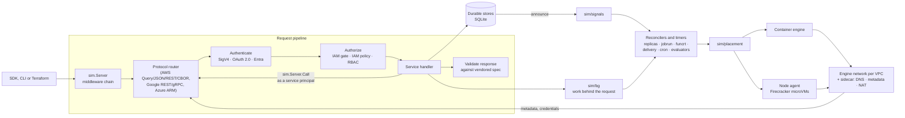
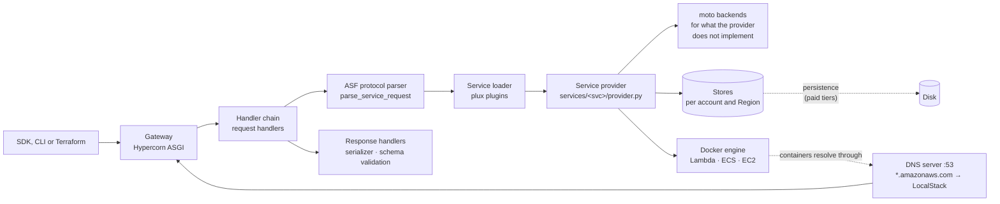
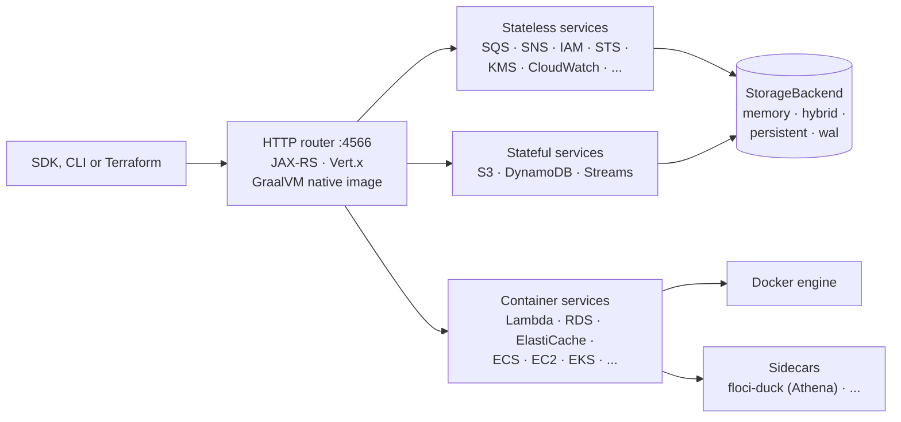

# So, you want to build your own cloud

This repository holds three clouds that run on a laptop: a slice of AWS, of
Google Cloud and of Microsoft Azure, each one Go binary. The official SDKs,
the vendor CLIs (`aws`, `gcloud`, `az`) and the Terraform providers talk to
them unmodified, differing from a real deployment only in the endpoint URL and
the credentials. Behind the APIs the work is real: a Lambda function runs in
its own execution environment, a Cloud Run job runs one container per task, an
Azure virtual machine boots, a Cloud SQL instance is a real PostgreSQL.

Three clouds built side by side show what a cloud is made of. The same dozen
mechanisms turn up under every vendor's names, and once a mechanism exists
once, each cloud's service on top of it is mostly wire shapes. This post
covers, in order:
- how a cloud's own API specification becomes the contract;
- the services a cloud cannot do without, and the APIs to build first;
- the libraries those services stand on;
- the control-plane machinery behind the public API;
- what is still missing;
- how the result compares with LocalStack and Floci.

[The tutorial](tutorial.md) builds one stack of those services on all three
simulators with Terraform, step by step.

## What a cloud is, seen from a client

A client sees three things:

1. **An API surface.** Operations with fixed paths, protocols, error shapes,
   status codes, pagination tokens and long-running-operation semantics. The
   clouds publish them as specifications — Smithy models for AWS, Discovery
   documents for Google Cloud, OpenAPI (Swagger) for Azure — and those
   specifications are the contract.
2. **Behaviour behind the surface.** A queue redelivers after its visibility
   timeout, a function cold-starts and then stays warm, a job retries a failed
   task, a deleted key waits out its pending window.
3. **Places a workload runs.** A network with its own address range, a
   resolver and a metadata endpoint at the addresses the cloud reserves, and
   credentials that reach the workload through the cloud's own channel.

A cloud is wire-faithful when all three hold. That gives the one rule this
project builds on: **a client of the simulator differs from a client of the
cloud only in coordinates.** No `if sim` in a test, no simulator-only header,
no shortcut a real client would never take. A shortcut proves the shortcut
works, never the client.

## From specification to served slice

Every cloud publishes its API as a machine-readable specification, and its
SDKs are generated from it: Smithy models for AWS, API Discovery documents and
Protocol Buffers definitions for Google Cloud, OpenAPI (Swagger) for Azure.
Treat those files as the contract.

- **Vendor them, pinned.** Copy each document into the repository, never edit
  it, and record where it came from and at which revision. A daily job
  compares every pin with upstream and re-vendors what moved.
- **Choose the slice by vendoring.** Vendoring a document commits you to
  serving every operation in it, or to saying, operation by operation, why
  not.
- **Generate tables, not handlers.** A generated stub would compile, answer
  and count as served while doing no work. Generate the things a hand would
  get wrong instead: the member an error's message lives under, the signing
  name of each service, the resource types each action authorizes.
- **Gate coverage.** Probe every documented method through the real handler
  chain, and fail the build when the served count moves without a reason. An
  unserved method answers a declared `501`, not a router's `404`.
- **Validate every response.** While the client suites run, check each
  response member by member against the specification.
- **Read the documentation for behaviour.** A specification states shapes. It
  says `RunInstances` returns a `Reservation`, not that the instance waits in
  `pending` until it boots. Vendor the documentation pages that state the
  behaviour, and capture the real cloud where they're silent.

[Specifications](specifications.md) covers each cloud's sources, the generated
tables, every gate and how to vendor a new document.

## Before the first service: the foundation

Every service needs the same plumbing, and building it once is the cheapest
work in the project. In this repository it lives in `sim/`, the framework the
three simulators share.

| Need | What it does | Where |
|---|---|---|
| Front door | One HTTP server per cloud with a middleware chain; each cloud plugs in its protocol router (AWS Query, JSON, REST-XML, REST-JSON and Smithy RPC v2 CBOR; Google Cloud REST and gRPC; Azure Resource Manager) and its error envelope through hooks | `sim.Server`, `Config.RewriteRequest` |
| Specification checks | Validate every response's shape against the vendored specification at run time, and hold coverage ratchets in CI | `specs/cloud-api/`, the coverage gates |
| Durable state | Typed stores on SQLite, generations, indexes; a restarted simulator resumes where it stopped | `sim.Store`, `PrefixStore`, `GenerationIndex` |
| Change signals | Wake a waiter when the record it waits on changes, instead of polling | `sim/signals`, `sim.Announcing` |
| Background work | Count every goroutine that outlives its request, so tests and shutdown can drain it | `sim/bg` |
| Service-to-service calls | A service calls another through the whole request chain, authenticated as the service's principal | `sim.Server.Call` |
| Lists | Offset and key-cursor pages, filter expressions, ordering | `sim/listq` |
| Identity plumbing | Sign and verify the simulator's own tokens, publish its JWKS, verify an external OpenID Connect issuer | `sim/simjwt`, `sim/oidcfed` |
| A container engine | Images, containers, networks and volumes through the Docker Engine API, as an unprivileged client | `sim` container layer |

Two rules shape the foundation:

- **A library holds mechanism, never wire shapes.** `sim/msgq` knows leases,
  visibility and redelivery; it does not know what an SQS receipt handle or a
  Pub/Sub `ackId` looks like. Each cloud keeps its names, error envelopes and
  state vocabulary, and reaches the library through hooks.
- **Time is the cloud's.** A wait ends on the event it stands for — a
  container exiting, a write landing, a long poll's message arriving — or on a
  timer the cloud itself documents. A simulator that sleeps for a guessed
  interval has invented a cloud behaviour nobody can rely on.

## The must-have core services

Here is the order to build them in. Each layer depends on the ones above it.

### 1. Identity and access

Every request needs a principal before anything else happens: verify the
signature or token, resolve who signed it, and decide whether the policy
allows the action on the resource.

- **AWS**: IAM, AWS STS, SigV4 on every request, and an authorization gate
  that derives each operation's resources from the Service Reference's ARN
  formats.
- **Google Cloud**: IAM, service accounts and keys, the Security Token
  Service, Workload and Workforce Identity Federation, OAuth 2.0 tokens.
- **Azure**: Microsoft Entra ID (users, groups, applications, service
  principals), Azure RBAC, managed identities.

Libraries: `sim/simjwt` and `sim/oidcfed`. Policy evaluation stays per cloud,
because the three policy languages share little beyond wildcard matching
(`sim.Wildcard`). [Identity and access](iam.md) documents all three.

### 2. Resource organisation

Every resource has an owner and an address: an AWS account and Region, a
Google Cloud project in a folder and organization, an Azure subscription and
resource group. Tags and labels hang off the same hierarchy.

- **AWS**: AWS Organizations, Regions and Availability Zones.
- **Google Cloud**: Resource Manager (projects, folders, tags), Service Usage.
- **Azure**: subscriptions, resource groups, tags, resource moves.

No shared library: the hierarchies differ in shape, and each is small.

### 3. Keys and secrets

Encryption at rest, envelope keys for other services, and secret values with
versions.

- **AWS**: AWS KMS, AWS Secrets Manager, Systems Manager Parameter Store.
- **Google Cloud**: Cloud KMS, Secret Manager.
- **Azure**: Key Vault keys, secrets and certificates, Managed HSM.

Library: `sim/simkms` holds AES-256-GCM sealing and RFC 5649 key wrapping.
Asymmetric keys, versioned secrets and soft-delete windows are still written
once per cloud (see the extractions below).

### 4. Networking

A workload needs an address in a range its owner chose, a resolver, a
metadata endpoint, firewall rules, a way out and a way in.

- **Virtual networks**: Amazon VPC, Compute Engine networks and subnetworks,
  Azure Virtual Network.
- **Fixed addresses inside the network**: the Amazon-provided DNS resolver and
  instance metadata at `169.254.169.254`, `metadata.google.internal`, Azure's
  resolver at `168.63.129.16` and its Instance Metadata Service.
- **Firewalls**: security groups and network ACLs, VPC firewall rules and
  firewall policies, network security groups.
- **DNS**: Amazon Route 53, Cloud DNS, Azure DNS and Private DNS.
- **Load balancing**: Elastic Load Balancing, Cloud Load Balancing, Azure Load
  Balancer and Application Gateway.
- **NAT**: NAT gateways, Cloud NAT, Azure NAT Gateway.

Libraries: `sim.EnsureCloudNetwork` with `sim/ipam` and `sim/netrules` make
each cloud network an engine network over its own range; `sim/sidecar` stands
at the addresses the cloud reserves inside the range and forwards the resolver
and metadata to the simulator; `sim/dnsserver` answers every zone; `sim/lbplane`
is the load-balancer data plane with its HTTP, TCP and gRPC health probes.
[Instance metadata](instance-metadata.md) documents what workloads read at
the reserved addresses.

The constraint worth stating: **no host privilege.** The simulator holds no
capability, device or `nftables` rule. An engine network stands in for the
VPC, a sidecar stands in for the reserved addresses, and firewall rules are
enforced where traffic is mediated and at a microVM guest's tap.

### 5. Compute

Four shapes, in the order to build them:

1. **Virtual machines**: Amazon EC2, Compute Engine, Azure Virtual Machines.
   Libraries: `sim/machine` (boot, stop keeping the disk, start, capture,
   adopt after a restart), `sim/vminstance` (catalog images, cloud-init over
   user data, an empty `/run` per boot), and `sim/placement` underneath.
2. **Containers as a service**: Amazon ECS and AWS Fargate, Cloud Run, Azure
   Container Apps and Azure Container Instances. Libraries: `sim/workload`
   (container groups with sidecars in one network namespace), `sim/replicas`
   (keep N running, probes, crash-loop back-off), `sim/revisions` (revision
   identity and traffic split), `lbplane.HostRouter` as the front end.
3. **Run-to-completion jobs**: AWS Batch, Cloud Run jobs, Container Apps jobs.
   Library: `sim/jobrun` (tasks, parallelism, retries, timeouts, cancel,
   restart recovery).
4. **Functions**: AWS Lambda, Cloud Run functions, Azure Functions. Library:
   `sim/funcrt` (warm execution environments, reserved and provisioned
   concurrency, event-source pollers). Cloud Run functions are Cloud Run
   services, and Azure Functions run as an App Service site's host process,
   so neither needs a pool of its own.

`sim/placement` is the hinge: one interface with a container backend and a
Firecracker microVM backend (through a node agent that holds `/dev/kvm`), and
the operator's configuration — never the cloud API — chooses between them.

### 6. Storage

- **Object storage**: Amazon S3, Cloud Storage, Azure Blob Storage. Library:
  `sim/blobstore`.
- **Block storage and images**: Amazon EBS volumes and snapshots, Compute
  Engine persistent disks and images. Library: `sim/sparse` (files whose holes
  stay holes), engine volumes and their snapshots.
- **File shares**: Amazon EFS, Azure Files. When a workload runs as a microVM
  guest, `sim/fileshare` serves the directories it mounts over NFSv4.

### 7. Container registry

Every compute service above pulls images. Amazon ECR, Artifact Registry and
Azure Container Registry share one OCI Distribution data plane and one
registry token flow in `sim` (`OCIRegistry` with each cloud's hooks,
`ociauth.go`).

### 8. Messaging and events

The glue between services, and the place where three clouds look most alike.

| Mechanism | AWS | Google Cloud | Azure | Library |
|---|---|---|---|---|
| Leased queues | Amazon SQS | Pub/Sub subscriptions, Cloud Tasks | Service Bus, Queue Storage | `sim/msgq` |
| Partitioned streams | Amazon Kinesis Data Streams | — | Event Hubs | `sim/streamlog` |
| Fan-out and routing | Amazon EventBridge, Amazon SNS | Pub/Sub topics, Eventarc | Event Grid | `sim/eventbus` |
| Push delivery with retries | Lambda async invocations, rule targets, SNS HTTP | Pub/Sub push, Cloud Tasks HTTP targets | Event Grid webhooks | `sim/delivery` |
| Schedules | EventBridge Scheduler, scheduled rules | Cloud Scheduler | Logic Apps recurrence | `sim/cron` |

### 9. Databases

- **Relational**: Amazon RDS, Cloud SQL, Azure Database for PostgreSQL flexible
  server. Library: `sim/dbengine` runs a real PostgreSQL, MySQL or MariaDB
  behind an endpoint that terminates TLS and authenticates through the cloud's
  own hook.
- **Key-value and document**: Amazon DynamoDB, Firestore, Bigtable, Spanner,
  Azure Cosmos DB. Library: `sim/kvstore` (throughput token buckets, per-key
  locks, expiry sweeps, change logs, entity-tag preconditions); each query
  language stays with its cloud.
- **Caches**: Amazon ElastiCache, Memorystore for Redis, Azure Cache for
  Redis. Only Memorystore runs a real Redis today (see the gaps).

### 10. Observability

- **Logs**: Amazon CloudWatch Logs, Cloud Logging, Azure Monitor Logs (Log
  Analytics). Library: `sim/logstore`.
- **Metrics and alarms**: Amazon CloudWatch metrics and alarms, Azure Monitor
  metrics. Cloud Monitoring is not served yet.
- **Audit**: AWS CloudTrail, Cloud Audit Logs, the Azure Activity Log.

### Beyond the core

Services worth having once the core stands, each built on the layers above:
build services (AWS CodeBuild, Cloud Build, Azure Container Registry Tasks),
workflows (AWS Step Functions, Azure Logic Apps), API gateways (Amazon API
Gateway, API Gateway, Azure API Management), web hosting (Azure App Service,
AWS Amplify Hosting), content delivery (Amazon CloudFront), analytics (AWS
Glue, BigQuery) — and a console, which reads only the cloud's real APIs and
signs its operator in through the cloud's own federation primitive.

## The APIs to build first

A cloud is useful long before it is complete. What decides the order is what
a client's loop calls: an infrastructure tool creates a resource, waits for it,
reads it back field by field, updates it, tags it and deletes it, and an
application then uses the resource's data plane. Build those calls for one
service end to end — including the read-back that makes a second
`terraform plan` empty — before starting the next.

| Service | The control-plane calls a client's loop makes | The data plane |
|---|---|---|
| Identity | AWS STS `GetCallerIdentity`, `AssumeRole`; IAM `CreateRole`, `PutRolePolicy`, `GetRole`; Google OAuth 2.0 token endpoint, `serviceAccounts.*`; Microsoft Entra token endpoint, ARM role assignments | Signature and token verification on every request |
| Amazon VPC / VPC network / Virtual Network | `CreateVpc`, `CreateSubnet`, `CreateSecurityGroup`, `AuthorizeSecurityGroupIngress`, route tables, `Describe*` with filters; `networks.insert`, `subnetworks.insert`, `firewalls.insert`; ARM `virtualNetworks`, `subnets`, `networkSecurityGroups` PUT, GET, DELETE | Addresses, DNS and metadata inside the network |
| NAT | `AllocateAddress`, `CreateNatGateway`, `DescribeNatGateways`; `addresses.insert`, `routers.insert` with a NAT; ARM `natGateways`, `publicIPPrefixes` | Egress for the private subnet |
| Virtual machines | `RunInstances`, `DescribeInstances`, `StopInstances`, `StartInstances`, `TerminateInstances`, `DescribeImages`; `instances.insert`, `get`, `stop`, `start`, `delete`, `images.getFromFamily`; ARM `virtualMachines` PUT, GET, `powerOff`, `start`, DELETE | Boot, cloud-init, instance metadata, serial console |
| Container service | `CreateCluster`, `RegisterTaskDefinition`, `CreateService`, `DescribeServices`, `DescribeTasks`, `UpdateService`, `DeleteService`; Cloud Run `services.create`, `get`, `patch`, `delete` with their operations; ARM `containerApps` and `managedEnvironments` | Running the containers and routing requests to them |
| Object storage | `CreateBucket`, `PutObject`, `GetObject`, `HeadObject`, `ListObjectsV2`, `DeleteObject`, the bucket configuration calls; `buckets.insert`, `objects.insert`, `objects.get`; ARM `storageAccounts` and Blob `Put Blob`, `Get Blob`, `List Blobs` | The objects themselves |
| Key-value or document store | `CreateTable`, `DescribeTable`, `PutItem`, `GetItem`, `Query`, `DeleteTable`; Firestore `documents.createDocument`, `get`, `patch`, `runQuery`; ARM `databaseAccounts`, `sqlDatabases`, `containers` and the Cosmos DB documents API | Reads and writes with the store's consistency |
| Queue | `CreateQueue`, `GetQueueUrl`, `GetQueueAttributes`, `SendMessage`, `ReceiveMessage`, `DeleteMessage`, `DeleteQueue`; Pub/Sub `topics.create`, `subscriptions.create`, `publish`, `pull`, `acknowledge`; ARM `namespaces`, `queues` and the Service Bus send and receive | Leases, visibility timeouts, redelivery and dead letters |
| Function | `CreateFunction`, `GetFunction`, `Invoke`, `CreateEventSourceMapping`; Cloud Functions `functions.create` with its build, `get`; ARM `sites` with `kind` functionapp, the deployment site's zip deploy, host keys | Execution environments, cold and warm starts, event sources |
| Logs and monitoring | `CreateLogGroup`, `PutLogEvents`, `FilterLogEvents`, `PutMetricData`, `PutMetricAlarm`, `DescribeAlarms`; Cloud Logging `entries.write`, `entries.list`, `metrics.create`; ARM `workspaces`, `components` and the Logs ingestion and query APIs | Log and metric ingestion, alarm evaluation |

Two calls every service needs and is easy to forget: **tagging** (Terraform
reads and writes tags on almost every resource) and **list with filters and
pages** (every `Describe*` and `list` call, and every data source).

## The library map

The 34 packages under `sim/`, by the layer they serve:

| Layer | Packages |
|---|---|
| Foundation | `sim` (server, stores, engine layer, registry), `signals`, `bg`, `listq`, `archive` |
| Identity | `simjwt`, `oidcfed` |
| Keys | `simkms` |
| Networking | `ipam`, `netrules`, `sidecar`, `dnsserver`, `lbplane` |
| Compute | `placement`, `nodeagent`, `machine`, `vminstance`, `workload`, `workloadhost`, `replicas`, `revisions`, `jobrun`, `funcrt`, `procimage` |
| Storage | `blobstore`, `sparse`, `fileshare` |
| Messaging | `msgq`, `streamlog`, `eventbus`, `delivery`, `cron` |
| Data | `dbengine`, `kvstore`, `logstore` |

[`sim/README.md`](../sim/README.md) describes each one, and
[Architecture](architecture.md) shows how they fit together. Each package
states its contract in its package documentation and proves it
in unit tests without a simulator. Each consumer keeps its SDK, CLI and
Terraform tests, which show that moving a cloud onto a library changed no
wire behaviour.

## The control plane behind the API

The public API is the thin part. Behind every `Create*` call sits machinery no
specification describes, and a cloud is mostly that machinery: the parts that
turn a stored record into running work, keep it running, and clean it up.
These are the ones this project had to build, and where each lives.

| Mechanism | What it does | Where |
|---|---|---|
| Request pipeline | Route by protocol, authenticate the signature or token, authorize against the policy, validate the response against the specification, write the cloud's error envelope | `sim.Server` middleware, each cloud's router and auth |
| Authorization derivation | Work out which resources and condition keys an operation touches, so a policy can be evaluated at all | AWS: the Service Reference's ARN formats; each cloud's IAM, IAM policy or RBAC evaluation |
| Durable state with change signals | Every resource is a row; a write announces its key, and whatever waits on that resource wakes | `sim.Store`, `sim.Announcing`, `sim/signals` |
| Asynchronous provisioning | Answer the request at once, then do the work behind it and move the resource through its states (`pending` → `running`, `CREATING` → `ACTIVE`), as the cloud does | `sim/bg`, long-running operations, each service's state machine |
| Reconcilers | Hold the declared state against reality: N replicas of a revision, the tasks of a job, warm function environments, event-source pollers, health checks | `sim/replicas`, `sim/jobrun`, `sim/funcrt`, `lbplane` probes |
| Timed work | Delivery retries with back-off, schedules, retention sweeps, TTLs, alarm evaluation — each on the cloud's documented cadence | `sim/delivery`, `sim/cron`, `kvstore.StartSweeper`, evaluators |
| Placement | Choose where a workload runs, and run it there: a container on the engine, or a Firecracker microVM on a node agent | `sim/placement`, `sim/nodeagent` |
| Network substrate | An engine network per VPC over the range the user chose; a sidecar at the addresses the cloud reserves, serving DNS, metadata and NAT egress | `sim.EnsureCloudNetwork`, `sim/ipam`, `sim/sidecar`, `sim/netrules` |
| Workload identity | Deliver credentials to code running inside the cloud through the cloud's own channel: instance metadata, the Lambda runtime's variables, the metadata server, managed identity | each cloud's metadata handlers behind the sidecar, `sim/simjwt` |
| Service-to-service calls | One service calls another through the whole request pipeline, as a service principal, so the callee's authorization and validation apply | `sim.Server.Call` |
| Front ends and DNS | Route data-plane traffic by host name to the workload behind it; answer every hosted zone | `lbplane.HostRouter`, `sim/dnsserver` |
| Restart recovery | A restarted process adopts the containers, guests and in-flight work the last one left, by label | each service's recovery, `SIM_PERSIST` |
| Garbage collection | Reap the containers, networks and volumes of a run that ended | the container reaper and the startup sweep |

## What is still missing

### Gaps in the core services

- **A managed cache engine.** Memorystore for Redis runs a real Redis
  topology; Amazon ElastiCache reports a cluster `available` without starting
  an engine, and Azure Cache for Redis serves only its Azure Resource Manager
  lifecycle. The fix is the same move `sim/dbengine` made for relational
  databases: lift Memorystore's engine into a `sim/cacheengine` and put all
  three caches on it.
- **Azure Managed Disks.** Azure's block storage, and with it disk snapshots
  and attaching data disks, is not served.
- **Cloud Monitoring.** Google Cloud has no metrics service, so nothing on
  Google Cloud can alarm or autoscale on a metric.
- **Azure Monitor metric alerts.** Azure Monitor serves metrics but no metric
  alert rules, so nothing on Azure can alarm on a metric.
- **Filestore.** Google Cloud has no managed file share.

### Extractions, ranked by value over effort

Mechanisms two or three clouds still implement separately (`PLAN.md`, M3):

1. **Long-running operation tracker.** Google Cloud operations, Compute Engine
   zone operations and Azure's asynchronous operations each track running →
   done with a result, a done signal and restart recovery.
2. **Asymmetric cryptography in `sim/simkms`.** RSA and EC keys, PSS, PKCS #1
   v1.5, ECDSA, OAEP and HMAC, written three times; Key Vault does not use
   `simkms` at all.
3. **Time-bounded soft delete.** Key Vault, AWS KMS pending deletion, Secrets
   Manager recovery windows, Cloud Storage soft delete, Cloud KMS version
   destruction, Blob and Files soft delete, the EC2 Recycle Bin.
4. **Managed cache engine** (above).
5. **Simulated certificate authority.** Nine sites call
   `x509.CreateCertificate` on their own.
6. **Versioned secrets.** Versions, stages and password generation shared by
   Secrets Manager, Parameter Store, Secret Manager and Key Vault.
7. **Metric time series and alarms.** CloudWatch's aggregation beside Azure
   Monitor's, as the base for Cloud Monitoring and for autoscalers that read
   metrics.
8. **Audit capture middleware.** CloudTrail and Cloud Audit Logs capture,
   extended to the Azure Activity Log.
9. **Build runner.** The step pipeline, workspace and push shared by CodeBuild,
   Cloud Build and ACR Tasks.
10. **Registry ingest.** Image ingestion behind ECR pull-through cache and
    Artifact Registry remote repositories, extended to ACR cache rules.
11. **Field masks and merge patch, idempotency tokens.** Small, repeated
    request semantics.

### Refactorings inside each cloud

- An ARN builder and parser for AWS, and shared tag-set helpers.
- Every workload through `sim/placement`, including the Azure App Service and
  Container Instances paths that still reach the engine directly.
- The copy-paste gate lowered from 150 to 120 tokens, clearing what it finds.

## How this compares with LocalStack and Floci

LocalStack and Floci are the two best-known local AWS emulators, and both
reach past AWS. The comparison below reflects their own documentation as of
October 2026; both move quickly, so check each project's current pages before
relying on a row.

| | sockerless-cloud | LocalStack | Floci |
|---|---|---|---|
| **License and cost** | AGPL-3.0, no account or token | One image, which needs an account and an auth token since 23 March 2026; a free Hobby tier for non-commercial use, paid Base, Ultimate and Enterprise tiers for commercial use | MIT, no account or token |
| **Clouds** | AWS, Google Cloud and Azure, one Go binary each | AWS; LocalStack for Azure in public preview; Snowflake | AWS (`floci`), with sibling emulators for Azure (`floci-az`), Google Cloud (`floci-gcp`) and Oracle Cloud (`floci-oci`) |
| **Built with** | Go, on a shared `sim` framework | Python | Java on Quarkus, compiled to a GraalVM native image |
| **Breadth** | Every operation of 42 vendored AWS Smithy models served or exempt; every method spelling of 33 Google Cloud Discovery documents routed; 2,653 of 2,660 Azure Swagger operations served | Broad AWS coverage; which services a user gets depends on the tier | Its site claims 126 AWS services; an independent review counted 85 in its service matrix |
| **Contract** | The cloud's own specification, vendored; responses validated against it at run time; coverage ratchets in CI | Not stated in the pages consulted | "Real wire protocols"; compatibility tests (below) |
| **Authentication** | SigV4 verified on every AWS request; an IAM gate authorizes every operation, always on | IAM enforcement off by default, enabled with `ENFORCE_IAM=1`; not on the Hobby tier | Any non-empty credentials by default; stricter checks opt-in per service |
| **Heavy services** | Real engines: PostgreSQL, MySQL and MariaDB for the managed databases, Redis for Memorystore, containers or Firecracker microVMs for compute | Container-backed RDS and ECS from the Base tier, EKS from Ultimate | Real engines in containers: Lambda runtimes, RDS, ElastiCache on Valkey, DocumentDB on MongoDB, MSK on Redpanda, EKS on k3s, and more |
| **Networks** | Each VPC, subnetwork or virtual network is an engine network over its own range, with the resolver, metadata and NAT at the addresses the cloud reserves | A DNS server that answers `*.amazonaws.com` with LocalStack's address; network behaviour not described | One Docker network per VPC; NAT gateways and routing are records |
| **State** | SQLite; with `SIM_PERSIST`, kept across restarts, and a restarted simulator adopts its workloads and resumes background work | Persistence and Cloud Pods from the Base tier | Four modes: memory, persistent, hybrid and write-ahead log |
| **Tests** | Every operation through the official Go SDK, the vendor CLI and the Terraform provider, enforced by a pre-commit hook | Not compared here | 2,576 compatibility tests across five SDKs (Java, Node.js, Python, Go, AWS CLI) and three IaC tools (Terraform, OpenTofu, CDK) |
| **Console** | One per cloud, reading only the cloud's real APIs, signing in through the cloud's own federation | A web application | `floci-ui` |

### The tutorial's services, tool by tool

The services [the tutorial](tutorial.md) builds, and how each tool serves
them. **Real** means the tool runs the work, such as a container for the
instance or task, a function runtime, or an egress path. **Record** means the
API stores and returns the resource but nothing runs behind it. **API** means
the operations exist and the pages consulted do not say what runs behind them.
LocalStack tiers are Hobby (H), Base (B), Ultimate (U) and Enterprise (E).

**AWS**

| Service | sockerless-cloud | LocalStack for AWS | Floci |
|---|---|---|---|
| Amazon EC2 | Real: a container or a Firecracker microVM per instance, booted with cloud-init | Real from Base, through its Docker VM manager; Hobby serves the API only | Real: a Docker container per instance |
| Amazon VPC | Real: an engine network over the VPC's own range; security groups enforced on mediated flows and at a microVM's tap | API; only the `default` security group, applied at instance creation | Real network: one Docker network per VPC; subnets are address slices; security groups and network ACLs not enforced unless the opt-in nftables mode is on |
| NAT gateway | Real: an egress sidecar | API | Record |
| Amazon ECS on AWS Fargate | Real: `awsvpc` tasks on the VPC's network | Real containers, from Base | Real containers, with an ENI per `awsvpc` task |
| Amazon S3 | Real | All tiers | Real (in-process) |
| Amazon DynamoDB | Real | All tiers, on its own emulator | Real (in-process) |
| AWS Lambda | Real: AWS's runtime images, warm reuse, concurrency limits | Real: AWS's runtime images, all tiers | Real: AWS's runtime images |
| Amazon SQS | Real | All tiers | Real (in-process) |
| Amazon CloudWatch | Real: metrics, alarms evaluated, Logs | All tiers; metric alarms evaluated, composite alarms not | Real: single-metric alarms evaluated, Logs |

**Google Cloud.** LocalStack has released no Google Cloud emulator.

| Service | sockerless-cloud | Floci (`floci-gcp`) |
|---|---|---|
| Compute Engine | Real: a container or microVM per instance, with the metadata server and serial console | Record: instance and disk lifecycle, no guest execution |
| VPC network and subnetwork | Real: an engine network per subnetwork range; firewall rules at a microVM's tap | Record |
| Cloud NAT | Real: an egress sidecar | Not listed |
| Cloud Run | Real: revisions scaled on request concurrency | Real: Docker |
| Cloud Storage | Real | Real (in-process) |
| Firestore | Real, including `Listen` | Real (in-process), including the listen stream |
| Cloud Run functions | Real: built from source, run as Cloud Run services | Record: control plane only, no invocation |
| Pub/Sub | Real, over REST and gRPC | Real (in-process), over REST and gRPC |
| Cloud Logging | Real | Real (in-process) |
| Cloud Monitoring | Not served | Real (in-process) |

**Azure**

| Service | sockerless-cloud | LocalStack for Azure (public preview) | Floci (`floci-az`) |
|---|---|---|---|
| Virtual Machines | Real: a container or microVM per machine, with cloud-init and the Instance Metadata Service | Not listed | Record by default; a Linux container per machine when `mocked` is off |
| Virtual Network | Real: an engine network per address prefix; network security groups at a microVM's tap | API | Record |
| NAT Gateway | Real: an egress sidecar | API | Not listed |
| Container Apps | Real: revisions, replicas, scale rules, ingress | Real: containers on a k3d cluster per environment; scaling and traffic weights not enforced | Real: Docker, with HTTP ingress |
| Blob Storage | Real | Real | Real (in-process) |
| Cosmos DB for NoSQL | Real: the documents API with keys and consistency levels | Real: the NoSQL data plane, no change feed or RU metering | Real (in-process) |
| Azure Functions | Real: the Functions host on the App Service platform | Real: the Functions host for Python, Node.js and .NET | Real: a warm container pool, HTTP triggers |
| Service Bus | Real, over REST and AMQP | API | An optional Artemis sidecar, or a record |
| Azure Monitor and Log Analytics | Real: Log Analytics and Application Insights; metric alerts not served | API | HTTP APIs, a subset of KQL |

Sources for these tables: [LocalStack licensing](https://docs.localstack.cloud/aws/licensing/),
LocalStack's [EC2](https://docs.localstack.cloud/aws/services/ec2/),
[ECS](https://docs.localstack.cloud/aws/services/ecs/),
[Lambda](https://docs.localstack.cloud/aws/services/lambda/),
[DynamoDB](https://docs.localstack.cloud/aws/services/dynamodb/) and
[CloudWatch](https://docs.localstack.cloud/aws/services/cloudwatch/) pages,
[LocalStack for Azure](https://docs.localstack.cloud/azure/) with its
[Container Apps](https://docs.localstack.cloud/azure/services/container-apps/),
[Cosmos DB](https://docs.localstack.cloud/azure/services/cosmos-db/) and
[Functions](https://docs.localstack.cloud/azure/services/functions-app/) pages;
Floci's [services](https://floci.io/floci/services/),
[EC2](https://floci.io/floci/services/ec2/),
[ECS](https://floci.io/floci/services/ecs/) and
[CloudWatch](https://floci.io/floci/services/cloudwatch/) pages, and the
[`floci-gcp`](https://github.com/floci-io/floci-gcp) and
[`floci-az`](https://github.com/floci-io/floci-az) READMEs.

### Three control planes

sockerless-cloud's control plane is drawn
[above](#the-control-plane-behind-the-api). LocalStack's and Floci's, as their
own architecture documentation describes them:

**LocalStack** ([concepts](https://github.com/localstack/localstack/blob/main/docs/localstack-concepts/README.md),
[DNS server](https://docs.localstack.cloud/aws/tooling/dns-server/)):

**Floci** ([README](https://github.com/floci-io/floci)):

The structural difference is where the work runs. LocalStack and Floci serve
most services inside their own process and send the heavy ones to Docker.
sockerless-cloud stores state in-process too, but every workload goes through
one placement interface onto a container or a microVM, on a network that
stands in for the cloud's own, so a VPC's addresses, resolver, metadata and
NAT behave as they do in the cloud.

Where each one fits:

- **LocalStack** offers the broadest commercial package: paid support, team
  features such as Cloud Pods, and per-tier services. Commercial use needs a
  paid plan.
- **Floci** is the fast, MIT-licensed AWS stand-in with a wide AWS service
  list and a small native-image footprint. It runs more of AWS's
  heavy services on real engines than sockerless-cloud does today, Amazon
  ElastiCache among them (BUG-3732). Its compatibility tests check the SDK and
  IaC calls they exercise; by default it accepts any credentials.
- **sockerless-cloud** is narrower per cloud and trades breadth for a contract:
  each operation it serves is checked against the cloud's own specification,
  signed and authorized as the cloud would, exercised through three real
  client surfaces, and backed by real work. Its three clouds share one
  framework, so one mechanism serves all three: the leased queue behind
  Amazon SQS, Pub/Sub and Azure Service Bus, the replica set behind Amazon
  ECS, Cloud Run and Azure Container Apps.

Sources: [LocalStack's pricing changes](https://blog.localstack.cloud/2026-upcoming-pricing-changes/),
[LocalStack licensing](https://docs.localstack.cloud/aws/licensing/),
[LocalStack IAM policy enforcement](https://docs.localstack.cloud/aws/capabilities/security-testing/iam-policy-enforcement),
[Floci](https://floci.io/), [Floci on GitHub](https://github.com/floci-io/floci),
[an independent Floci and LocalStack review](https://wavect.io/blog/floci-vs-localstack-aws-emulator.md).

## Rules that kept three clouds honest

- **Specifications are the contract.** Vendor them, validate against them at
  run time, and ratchet coverage so a served operation never silently
  disappears.
- **Test through the real clients.** Every operation is exercised through the
  official SDK, the vendor CLI and the Terraform provider.
- **No fakes.** A stubbed engine, a hardcoded account ID or a status set to
  "available" without the work behind it is a bug, filed and fixed.
- **Wait on events.** A test waits on the SDK's waiter or the operation's
  completion; a simulator waits on the engine or a change signal.
- **No privilege.** The container engine is the only privileged thing the
  simulator talks to; anything that needs more runs in a node agent the
  operator chose to deploy.
- **Placement is configuration.** Whether a workload is a container or a
  microVM is the operator's choice, invisible to the cloud API.
- **Mechanism once, wire shapes per cloud.** When a second cloud needs a
  mechanism the first already has, extract it.
