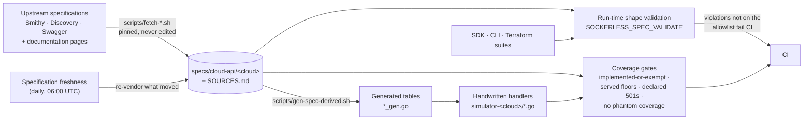

# Specifications

Every cloud publishes its API as a machine-readable specification, and the
cloud's SDKs are generated from it. This project treats those files as the
contract:
- it vendors them, pinned and never edited;
- it chooses its service slices by vendoring;
- it generates the tables a handler would otherwise get wrong by hand;
- it checks every route, every operation and every response against them.

This page covers where each specification comes from, what is generated from
it, how coverage is checked and how to add or refresh one.



## Where each specification comes from

| Cloud | What | Upstream | Fetched by | Pinned to |
|---|---|---|---|---|
| AWS | Smithy 2.0 JSON models, one per service (42) | `codegen/sdk-codegen/aws-models/<service>.json` in [`aws/aws-sdk-go-v2`](https://github.com/aws/aws-sdk-go-v2), the models the AWS SDKs are generated from | `scripts/fetch-aws-spec.sh <service> [<ref>]` | A commit SHA |
| AWS | The Service Reference: each action's resource types, ARN formats and condition keys (43 services) | `servicereference.us-east-1.amazonaws.com`, the JSON behind the Service Authorization Reference | `scripts/fetch-aws-service-reference.sh <service>` | The document's content hash |
| Google Cloud | API Discovery documents, one per API version (33) | `https://<api>.googleapis.com/$discovery/rest?version=<v>`, or the central `https://www.googleapis.com/discovery/v1/apis/<api>/<v>/rest` | `scripts/fetch-gcp-discovery.sh <host> <version>` | The document's `revision` |
| Google Cloud | Protocol Buffers definitions of the gRPC services | [`googleapis/googleapis`](https://github.com/googleapis/googleapis), compiled into the `cloud.google.com/go` client libraries | The `…pb` packages the simulator imports for its gRPC listener | The client library version in `go.mod` |
| Azure | OpenAPI 2.0 (Swagger) documents per resource provider and API version, for Azure Resource Manager and the data planes (129) | `specification/<service>/resource-manager/…` and `…/data-plane/…` in [`Azure/azure-rest-api-specs`](https://github.com/Azure/azure-rest-api-specs) | `scripts/fetch-azure-spec.sh <upstream-path> <local-name>` | A commit SHA |
| All | Documentation pages that state what a specification leaves out: timeouts, defaults, state machines, error texts, event tables | AWS guides on GitHub and `docs.aws.amazon.com`, Google Cloud documentation, Microsoft Learn's Markdown sources in the `MicrosoftDocs` organization | `scripts/fetch-aws-doc.sh`, `fetch-aws-docs-page.sh`, `fetch-gcp-doc.sh`, `fetch-azure-doc.sh` | The commit that last touched the page, or the page's content hash |
| All | Published catalogs a service reads: Amazon EC2 instance types, Elastic Load Balancing hosted zones, Google Cloud Armor expression sets, Cloud Interconnect locations, the Kudu sources Azure App Service runs | The clouds' own published files | `scripts/fetch-aws-ec2-instance-types.go`, `fetch-aws-elb-hosted-zones.sh`, `fetch-gcp-cloud-armor-expression-sets.sh`, `fetch-gcp-interconnect-*.sh`, `fetch-kudu-source.sh` | As each script records |

- **Format.** Every file is gzipped, never edited, and committed. CI and
  builds read only the committed copies; nothing downloads a specification at
  build or test time.
- **Provenance.** Each `specs/cloud-api/<cloud>/SOURCES.md` row records the
  local file, the upstream repository or host, the exact path, the licence,
  the pin and the fetch time.
- **Azure API versions.** These follow what the pinned clients actually send:
  the SDK modules in `simulator-azure/sdk-tests/go.mod`, and the
  `go-azure-sdk` packages terraform-provider-azurerm imports.

### Behaviour the specification doesn't state

A specification states shapes, not behaviour. The EC2 model says
`RunInstances` takes an `InstanceType` and returns a `Reservation`. It doesn't
say the instance waits in `pending` until its machine boots, or that a deleted
AWS KMS key waits out a seven-to-thirty-day pending window. That comes from the
vendored documentation pages. Where they're silent too, the simulator matches a
capture from the real cloud. Until a capture exists, a `BUGS.md` row records
the gap and the reasoning behind the chosen behaviour.

### Corrections: supplements

A model is sometimes wrong about what the cloud sends. For example, Amazon S3's
`GetObject` declares only `200`, but a ranged read answers `206`. Such a
correction goes in `specs/cloud-api/<cloud>/<document>.supplement.json`, with
its evidence. Each correction pins the exact upstream value it replaces, so a
re-vendor that changes that value fails the loader instead of silently
applying a stale correction. The supplements are:
- AWS: `acm`, `cloudwatch-logs`, `eventbridge` and `s3`;
- Google Cloud: `cloudrun-v2` and `discovery-v1`.

## What is generated, and what isn't

The handlers are handwritten. A generated stub per operation would compile and
answer, and would count as served while doing no real work, which this project
treats as a bug. The specifications generate the tables a handler would
otherwise get wrong by hand. After every re-vendor,
`scripts/gen-spec-derived.sh` regenerates:

| Generated file | From | What it gives the handlers |
|---|---|---|
| `simulator-aws/aws_error_members_gen.go` | Every vendored Smithy model | The member each error shape carries its message under (`message` or `Message`; the models disagree and each SDK reads exactly one), the service shape behind each `X-Amz-Target`, and each service's SigV4 signing name |
| `simulator-aws/cloudwatch_cbor_shapes_gen.go` | The Amazon CloudWatch model | Each operation's shapes reduced to what Smithy RPC v2 CBOR and AWS JSON 1.0 encode differently, so one handler serves both protocols |
| `simulator-aws/stepfunctions_rest_integrations_gen.go` | The models' HTTP traits | The REST routing table for AWS Step Functions' AWS SDK integrations, which the IAM gate also uses to name a REST request's operation |
| `simulator-aws/iam_resource_types_gen.go` | The Service Reference | The resource types and ARN formats each action authorizes against, which the Smithy models don't carry |
| `simulator-gcp/audit_methods_vendored.json` | The vendored audit-logging pages | Which methods each service audits, under which `methodName` and log category, checking which permissions |

The conformance tests check each generated table against the specification it
came from.

## How coverage is checked

Each simulator measures how much of every vendored specification it serves.
The build fails when that number moves without a stated reason.

| Check | AWS | Google Cloud | Azure |
|---|---|---|---|
| Every route names a real operation | `TestJSONTargetsExistInSmithyModels`, `TestQueryActionsExistInSmithyModels`, `TestRESTRoutesExistInSmithyModels` | The per-method probe below | The per-operation probe below |
| Every operation is served or accounted for | `TestVendoredModelOperationsAreImplementedOrExempt`: an operation no handwritten source names fails unless an exemption gives a reason, either a routing equivalence or an open `BUGS.md` row | `TestServiceConformance_GCPCoverageFloor`: each documented method becomes a concrete request sent through the real handler chain, and the served count per document is an exact-equality floor | `TestServiceConformance_AzureCoverageFloor`: the same probe and floor per Swagger document |
| A re-vendor can't add operations silently | The same test: a new operation is unnamed until it is served or exempt | `gcpDeclaredMethodTotals` locks each document's method count | `azureDeclaredOperationTotals` locks each document's operation count |
| An unserved operation says so | The protocol's own unknown-operation error | `TestServiceConformance_GCPUnservedMethodsDeclareThemselves`: a declared `501` naming what is missing, never the router's `404` | `TestServiceConformance_AzureUnservedOperationsDeclareThemselves` |
| No phantom coverage | `TestServiceConformance_LegacyQueryShadowing`: one service's handler must not answer another service's operation | `TestServiceConformance_GCPNoPhantomCoverage`: a method counts only if the route that answered names it | `TestServiceConformance_AzureNoPhantomCoverage`, case-insensitive like Azure Resource Manager paths |
| The probe is sound | — | `TestServiceConformance_GCPCoverageProbeIsSound`, and a gRPC floor per service (`TestGRPCCoverageFloor`) | `TestServiceConformance_AzureCoverageProbeIsSound`, `TestServiceConformance_AzureProbedHandlersAreHealthy` |
| Responses match the shapes | Run-time validation (below) | The same | The same |
| Real clients exercise every operation | `scripts/check-simulator-tests.sh`: a commit that registers an operation must add an SDK, CLI or Terraform test naming it, or a `tests-exempt.txt` line with the reason | The same | The same |
| The record is readable | `specs/SIM_SURFACE_TABLES/<surface>.md`, generated by `scripts/seed-surface-tables.sh`: per operation, its handler and its SDK and Terraform tests | The same | The same |

The Google Cloud and Azure gates send a real request because matching a
documented path against route patterns by shape alone over-counts. A
`{+name}` template under an unrelated route, or a colon-verb handler that
matches every custom method and then rejects the verb, would make a method
look served. Only the response says whether a handler serves it.

### Run-time shape validation

With `SOCKERLESS_SPEC_VALIDATE=<report.jsonl>` and
`SOCKERLESS_SPEC_DIR=specs/cloud-api/<cloud>` set, the simulator checks every
response body member by member against the specification's output shape,
covering unknown members and type mismatches, and appends each violation to the
report. CI arms it for every SDK and CLI suite. `scripts/check-spec-violations.sh`
then fails on any violation not listed in
`simulator-<cloud>/spec-violation-allowlist.txt`.
- Every allowlist line cites the open bug that explains it, and the list only
  shrinks.
- A member the cloud sends but the specification omits goes in a supplement,
  with evidence, rather than on the allowlist, where its value would stop
  being checked.
- The AWS and Google Cloud allowlists are empty; Azure's has four lines.

## How a slice is chosen

A slice is chosen by vendoring. Vendoring a specification commits the
simulator to serving every operation in it, or to accounting for each one it
doesn't.

- **AWS: by service model.** Every operation of a vendored model must be
  implemented or exempt. `TestVendoredModelsAreConsumed` refuses a model
  nothing uses, so a model is vendored when its service is built. An exemption
  is either a routing equivalence, or an open bug such as an operation newer
  than the SDK release the tests can pin. An example of a routing equivalence
  is the Amazon S3 bucket operations served through subresources such as `?acl`
  and `?cors`; `TestS3SubresourceExemptionsAreRouted` holds those to their
  routes.
- **Google Cloud: by Discovery document.** Every method must reach a route
  that serves it, or that answers a declared `501`. The per-document floor
  records the honest served count. Compute Engine's 2,000-odd methods are far
  from all served, and the floor shows it.
- **Azure: by Swagger document.** A resource provider enters with its
  documents at one API version. Every operation is served or answers a
  declared `501`.

Within a service, build first the calls a client's create, wait, read,
update, tag and delete loop makes.
[The blog post](so-you-want-to-build-a-cloud.md#the-apis-to-build-first) lists
them for the core services.

## Adding or refreshing a specification

To serve a new service or API version:

```sh
# AWS: vendor the service's Smithy model, pinned to a commit of aws-sdk-go-v2
scripts/fetch-aws-spec.sh ecs
scripts/fetch-aws-service-reference.sh ecs

# Google Cloud: vendor a Discovery document
scripts/fetch-gcp-discovery.sh storage.googleapis.com v1

# Azure: vendor a Swagger document under a local name
scripts/fetch-azure-spec.sh \
  specification/app/resource-manager/Microsoft.App/ContainerApps/stable/2025-01-01/ContainerApps.json \
  app-arm-containerapps-2025-01-01

# Any cloud: vendor the documentation page that states the behaviour
scripts/fetch-azure-doc.sh MicrosoftDocs/azure-docs-rest-apis \
  docs-ref-conceptual/storageservices/Put-Block-List.md storage-put-block-list live
```

Each fetcher validates the document, gzips it and writes its `SOURCES.md` row.
Then:

1. Run `scripts/gen-spec-derived.sh` if the change touches a source of a
   generated table.
2. Run the simulator's unit tests (`make simulator-<cloud>/unit-test`). The
   conformance gates name every operation the change added or moved.
3. Serve each named operation with its SDK, CLI and Terraform tests, or record
   why not: an exemption with its bug for AWS, a declared `501` for Google
   Cloud and Azure.
4. Regenerate the surface tables: `bash scripts/seed-surface-tables.sh`.

`scripts/check-spec-freshness.sh` compares every pin with its upstream. The
**Specification freshness** workflow runs it daily at 06:00 UTC, and
`scripts/refresh-drifted-specs.sh` re-vendors what drifted through the same
fetchers. The refresh lands together with whatever it changes: regenerated
tables, moved floors, and the new operations served or declared.

## Where the records live

| Path | Holds |
|---|---|
| `specs/cloud-api/<cloud>/` | The vendored files and `SOURCES.md` |
| `specs/SIM_SURFACE_TABLES/` | One table per surface: each operation, its handler, its SDK and Terraform tests |
| `specs/SIM_PARITY_MATRIX.md` | Which slices each simulator exposes, and where each slice's operations are tracked |
| `specs/SIM_TEST_COVERAGE_MATRIX.md` | Which client suite covers each surface; `scripts/check-simulator-coverage-matrix.sh` keeps it in step with the surface tables |
| `specs/AWS_BEHAVIORAL_PATTERNS.md` | Every background evaluator, listener and fan-out path in the AWS simulator, with the test that proves it; `scripts/check-behavioral-coverage.sh` enforces it |
| `simulator-<cloud>/tests-exempt.txt` | Operations no SDK, CLI or Terraform client exposes, each with its reason |
| `simulator-<cloud>/spec-violation-allowlist.txt` | Accepted run-time shape violations, each with its bug |
